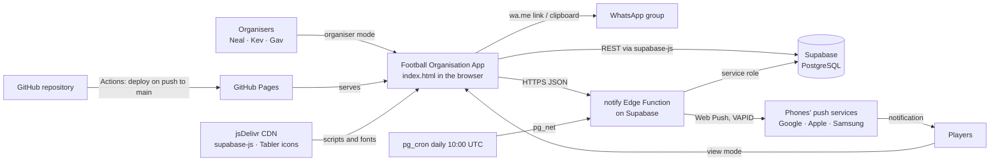
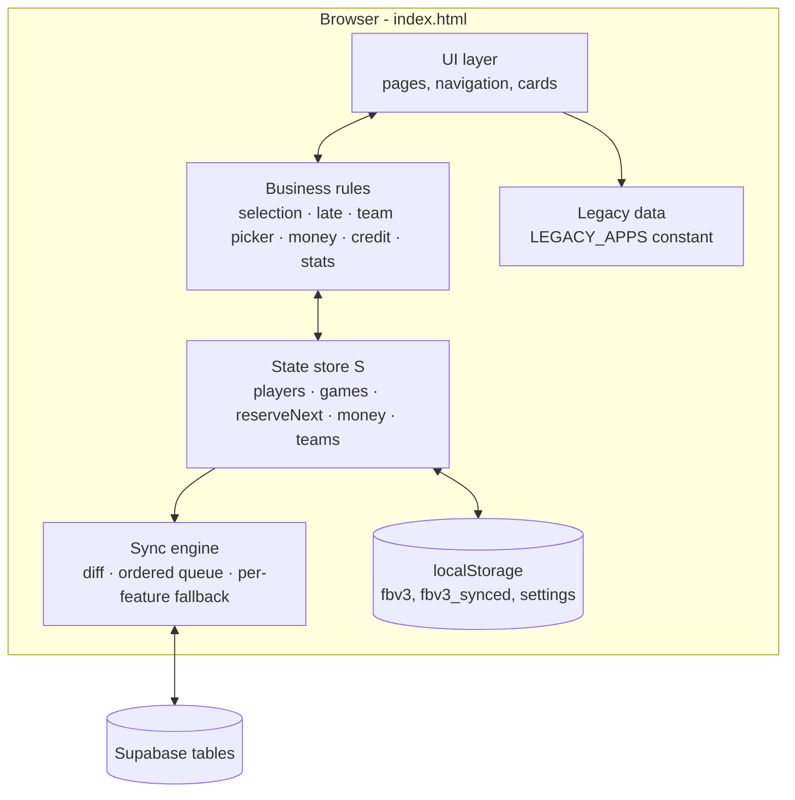
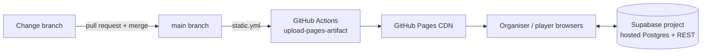
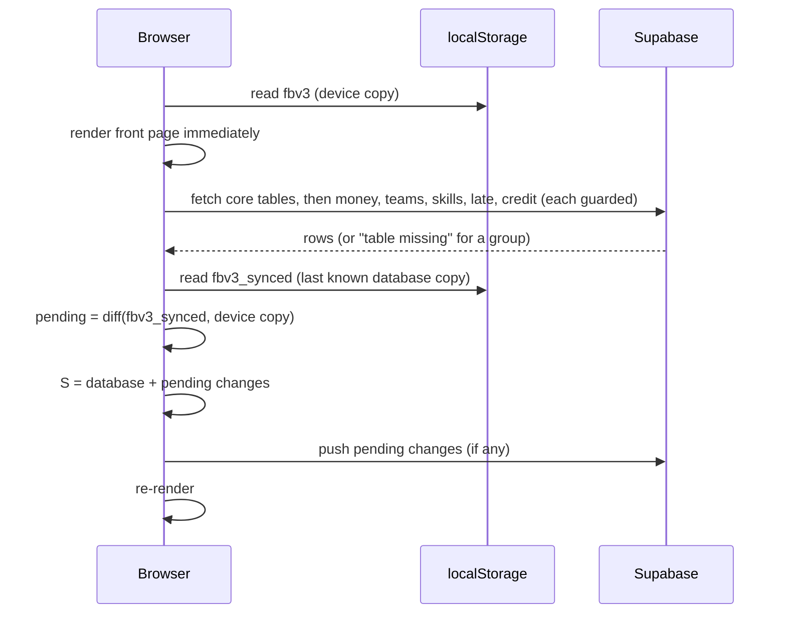
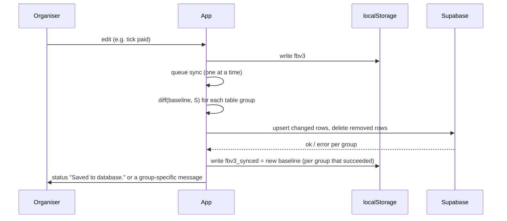
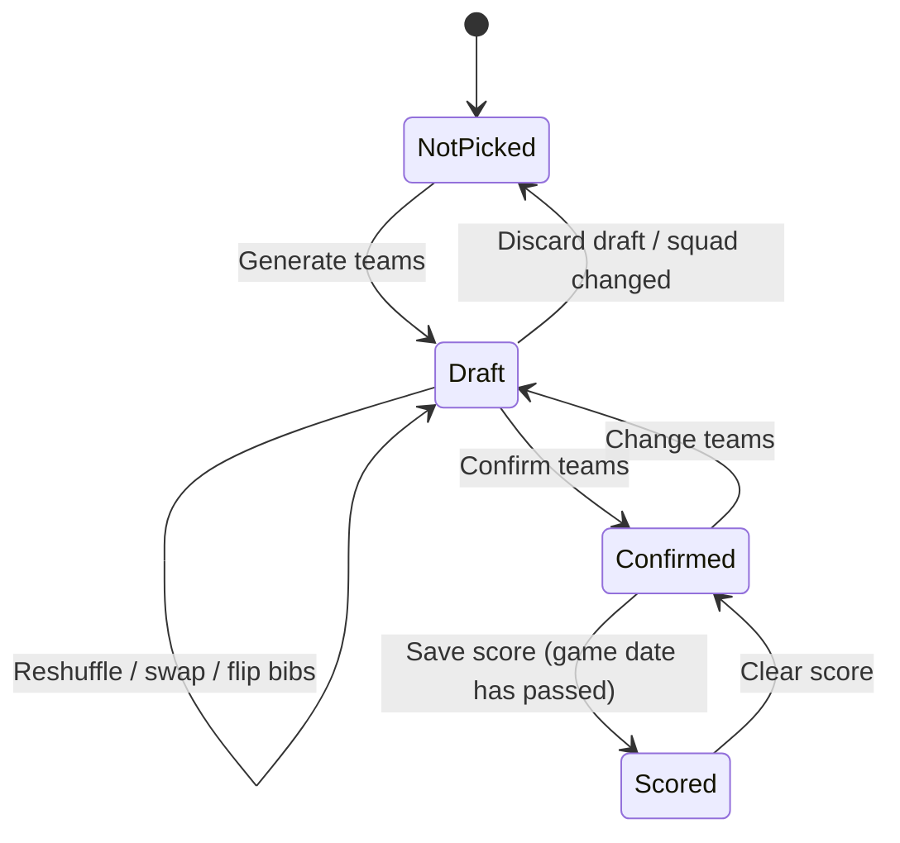
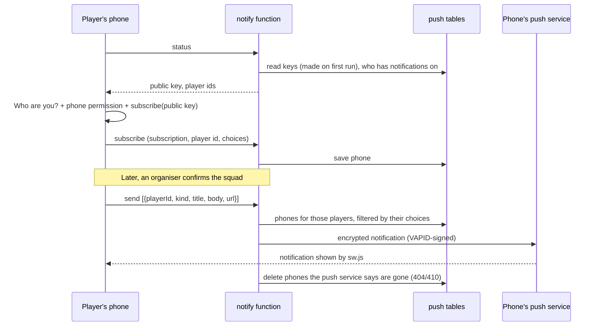
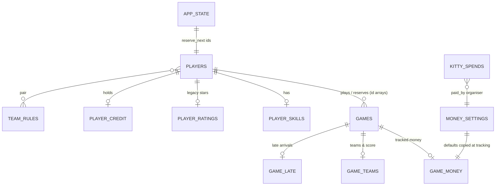

# Football Organisation App: Solution Design Document

| | |
|---|---|
| **Document** | Solution Design Document (SDD) |
| **Version** | 2.6 |
| **Release** | Production Release 2.6 |
| **Status** | Approved for production |
| **Date** | 24 October 2026 |
| **System** | Brent Football (Football Organisation App: `index.html`, GitHub Pages, Supabase and the `notify` Edge Function) |
| **Repository** | `nealpatel87np/FootballApp` |
| **Companion document** | [`docs/SYSTEM_SPEC.md`](SYSTEM_SPEC.md): page-by-page functional specification |

---

## Contents

1. [Document control](#1-document-control)
2. [Introduction](#2-introduction)
3. [Business context](#3-business-context)
4. [Requirements](#4-requirements)
5. [Solution overview](#5-solution-overview)
6. [Architecture](#6-architecture)
7. [Component design](#7-component-design)
8. [Data design](#8-data-design)
9. [Integration design](#9-integration-design)
10. [Security design](#10-security-design)
11. [User experience design](#11-user-experience-design)
12. [Non-functional design](#12-non-functional-design)
13. [Environments, deployment and release](#13-environments-deployment-and-release)
14. [Testing](#14-testing)
15. [Operations and support](#15-operations-and-support)
16. [Design decisions](#16-design-decisions)
17. [Risks, issues and constraints](#17-risks-issues-and-constraints)
18. [Future roadmap](#18-future-roadmap)
19. [Appendices](#19-appendices)

---

## 1. Document control

### 1.1 Versioning policy

This document and the application share one version number, **MAJOR.MINOR**.

| Change | Version | Examples |
|---|---|---|
| **Minor adjustment** | 1.0 → 1.1 → 1.2 | Wording or labels, layout tweaks, an extra column, a small rule change, bug fixes, legacy data corrections |
| **Major overhaul** | 1.x → 2.0 | A new page or workflow, a change to squad, team or money logic, new or restructured database tables, new hosting or database |

If you aren't sure, treat the change as **minor** unless it changes the data model (section 8) or a core rule (section 7.4).

### 1.2 Change procedure

1. **Agree the change.** A mock-up or preview is produced for anything visual.
2. **Build and test it** on a working branch, at phone width (375–390px) and desktop width (1280px), with the database blocked so live data is never touched in testing.
3. **Update this document** (version, revision history, affected sections) and [`SYSTEM_SPEC.md`](SYSTEM_SPEC.md).
4. **Merge** the pull request into `main`. GitHub Pages deploys automatically.
5. **Tag** the merge commit `vMAJOR.MINOR` on GitHub (*Releases → Draft a new release*).
6. **Run any new SQL file** once in Supabase (section 13.3).

### 1.3 Revision history

| Version | Date | Author | Summary |
|---|---|---|---|
| 1.0 | 22 Oct 2026 | Organisers with Claude Code | First production release. Baseline design for every feature in the app at that date. |
| 1.1 | 23 Oct 2026 | Organisers with Claude Code | Added explicit Data API `grant` statements to every SQL script, after Supabase's change to grants for new tables (30 Oct 2026). New tables must include them (13.3). No app change. |
| 1.2 | 23 Oct 2026 | Organisers with Claude Code | Installable app: named **Brent Football** (page title and heading), with app icon, web app manifest and service worker for home-screen install and opening offline. |
| 1.3 | 24 Oct 2026 | Organisers with Claude Code | **Availability message** card on Run game (hidden until Show) builds the pre-game WhatsApp availability message for Monday or Thursday (19.1). No data change. |
| 2.0 | 24 Oct 2026 | Organisers with Claude Code | **Push notifications** (7.5): "Who are you?" opt-in, Notifications page with per-type choices, squad, teams, payment-reminder and credit-used notifications, daily automatic reminders. New `notify` Edge Function, two new closed tables (`push_subscriptions`, `push_config`) and a schedule. |
| 2.1 | 24 Oct 2026 | Organisers with Claude Code | The daily reminder schedule now sends the publishable key, because Supabase only lets requests reach the function with the project's key. Re-run `push-cron.sql`. |
| 2.2 | 24 Oct 2026 | Organisers with Claude Code | Setup page shows organisers whether notifications are connected, and why not (function unreachable, wrong code deployed, or the error it returned). |
| 2.3 | 24 Oct 2026 | Organisers with Claude Code | Turning notifications on gives up with a clear message at whichever step stalls (permission, background helper, the phone's push service, saving the phone) instead of waiting on "Turning on…". Registers the service worker if it's missing. |
| 2.4 | 24 Oct 2026 | Organisers with Claude Code | Front page shows the app version (`APP_VERSION`). Turning on shows each step as it happens. Permission works with older callback-style browsers. The service worker fetches the app's own files with `no-cache`, so a release isn't held back by GitHub Pages' 10-minute browser cache. |
| 2.5 | 24 Oct 2026 | Organisers with Claude Code | Delivery checks on the Notifications page: the service worker tells an open app when a push arrives (and whether it was shown), **Show one on this phone** displays a local notification, and the page shows the phone's push service and the version. The test reports how many phones it was sent to. |
| 2.6 | 24 Oct 2026 | Organisers with Claude Code | Notifications use `renotify` and a vibration pattern, so a repeat with the same tag still alerts. Runbook covers Samsung showing site notifications silently. |

### 1.4 Approval

| Role | Name | Decision |
|---|---|---|
| Product owner and organiser | Neal | Approved (production release 1.0) |
| Organiser | Kev | |
| Organiser | Gav | |

---

## 2. Introduction

### 2.1 Purpose

This document describes **how** the Football Organisation App is designed and built: its architecture, components, data, integrations, security, and how it's deployed and supported. It's the reference for anyone changing, running or reviewing the system.

### 2.2 Scope

**In scope:**
- the organisation web app (`index.html`) and its Supabase database
- its build and deployment pipeline (GitHub Pages)
- the SQL setup scripts in `supabase/`
- appearance data brought over from the old spreadsheet

**Out of scope:**
- the unrelated starter app in the same repository (`server.js`, `public/`, SQLite)
- venue booking
- online payment processing
- player accounts

### 2.3 Audience

- **Organisers**, who run the group and approve changes.
- **Anyone maintaining the code.**

### 2.4 References

| Reference | Location |
|---|---|
| Functional specification | `docs/SYSTEM_SPEC.md` |
| User guide | `README.md` ("Football organisation page") |
| Database setup scripts | `supabase/*.sql` |
| Deployment workflow | `.github/workflows/static.yml` |

### 2.5 Definitions

See the glossary in Appendix 19.5.

---

## 3. Business context

### 3.1 Background

The group plays twice a week, on **Monday** and **Thursday** evenings, typically 5-a-side or 6-a-side with up to 12 players. Three organisers (Neal, Kev, Gav) take turns running games, collecting £8.50 per player and paying for the pitch (£80). Any surplus goes into a shared **kitty**, spent on footballs, kit and socials.

Until October 2026 this was all managed in a spreadsheet with manual WhatsApp messages. That made it hard to:
- be fair about who gets a place when more than 12 want to play;
- balance teams;
- track who has paid and who owes;
- keep history.

### 3.2 Objectives

| ID | Objective |
|---|---|
| OBJ-1 | Pick each squad fairly and consistently, honouring guaranteed places, reserve promises and penalties for lateness. |
| OBJ-2 | Produce balanced teams quickly, close to kick-off. |
| OBJ-3 | Generate WhatsApp messages in the group's usual format with one tap. |
| OBJ-4 | Know at any time who owes money, how much is in the kitty and who holds it. |
| OBJ-5 | Keep a long-term record of games, scores, appearances and statistics, including the spreadsheet history. |
| OBJ-6 | Work well on a phone, cost nothing to run and need no server administration. |

### 3.3 Stakeholders

| Stakeholder | Interest |
|---|---|
| Organisers (Neal, Kev, Gav) | Run games, manage money, maintain data. Full access. |
| Players | See the next game, teams, stats and what they owe. Read-only access. |

### 3.4 Success measures

- A squad and its WhatsApp message take under two minutes.
- Teams take under one minute.
- Outstanding money is visible at a glance.
- No double counting between the spreadsheet history and the app.

---

## 4. Requirements

### 4.1 Functional requirements

| ID | Requirement | Priority | Section |
|---|---|---|---|
| FR-01 | Maintain a player list with availability (Monday, Thursday or both), preferred day and guaranteed lists for each day. | Must | 7.4.1 |
| FR-02 | Pick a squad of up to 12 for a Monday or Thursday game from the available players, using the defined selection order. Extra players become reserves. | Must | 7.4.1 |
| FR-03 | Give last game's reserves a guaranteed place next game. | Must | 7.4.2 |
| FR-04 | Let organisers mark late arrivals, and place late players after non-guaranteed players at their next game. | Must | 7.4.3 |
| FR-05 | Rate players 1–10 on Attack, Defence, Fitness and Goalkeeping, with an auto or manual position and a regular keeper flag. | Must | 7.4.5 |
| FR-06 | Generate balanced teams, honouring keep-apart and same-team rules, spreading regular keepers evenly and balancing keepers. A coin flip decides the bibs. | Must | 7.4.4 |
| FR-07 | Hold teams as a shared draft until confirmed. Show confirmed teams on the front page. | Must | 7.3.4 |
| FR-08 | Produce availability, squad and teams WhatsApp messages in the group's format, with copy and open-in-WhatsApp. | Must | 19.1 |
| FR-09 | Record the score of each game with confirmed teams. | Must | 7.4.6 |
| FR-10 | Show player statistics (played, won, drawn, lost, win %) from scored games only. | Must | 7.4.6 |
| FR-11 | Show attendance (appearances by year, total, times in reserve) to organisers, including spreadsheet history, without affecting any other logic. | Must | 7.4.9 |
| FR-12 | Track each game's money on request: organiser, who paid, the split between pitch, admin and kitty. | Must | 7.4.7 |
| FR-13 | List outstanding payments by player and game, with Clear per game and per player, linked to the game's paid ticks. | Must | 7.4.7 |
| FR-14 | Hold player credit and apply it automatically to future games. | Should | 7.4.8 |
| FR-15 | Keep a kitty ledger with spends, starting balances and each organiser's holdings. | Must | 7.4.7 |
| FR-16 | Read-only View mode for players. Organiser mode behind a password. | Must | 10 |
| FR-17 | Export and import all data, and export a CSV game log. | Should | 7.3.9 |
| FR-18 | Show the next game, its teams or squad, and the kitty on a front page. | Must | 7.3.1 |
| FR-19 | Let each player turn on push notifications on their phone and choose which kinds they get. Notify players when the squad or teams are confirmed, when they owe money (by organiser and automatically the day after a game) and when credit is used. | Should | 7.5 |

### 4.2 Non-functional requirements

| ID | Requirement |
|---|---|
| NFR-01 | **Usability:** mobile-first. Works from 375px wide with no sideways scrolling. Phone navigation within thumb reach. |
| NFR-02 | **Availability:** opens and shows the last data even when the database is unreachable. Changes made offline are sent later. |
| NFR-03 | **Data integrity:** a device with stale data must never delete rows it hasn't seen. Concurrent edits resolve per row. |
| NFR-04 | **Cost:** no running costs. Free tiers of GitHub Pages and Supabase. |
| NFR-05 | **Maintainability:** a single file with no build step. Plain JavaScript. |
| NFR-06 | **Resilience to setup gaps:** each feature's data degrades to device-only storage if its table hasn't been created, without breaking other features. |
| NFR-07 | **Performance:** team generation feels instant for squads of up to 14, and stays reasonable up to 20. |
| NFR-08 | **Accessibility:** labelled controls, visible focus, reduced motion respected, light and dark themes. |

### 4.3 Constraints

- Static hosting only (GitHub Pages). No server-side code.
- The database is accessed directly from the browser with a public (publishable) key.
- Organisers may edit on different phones at the same time.

### 4.4 Assumptions

- The group stays small: under about 150 known players and around 100 games a year.
- The organisers are trusted. Players are honest viewers.
- The squad size of 12 and the twice-weekly pattern are stable.

---

## 5. Solution overview

### 5.1 Approach

The solution is a **single-page web application** served as a static file, using **Supabase** (hosted PostgreSQL with an auto-generated REST API) as the shared data store. All business logic runs in the browser. Every device keeps a full copy of the data in `localStorage` and syncs changes to Supabase row by row.

### 5.2 System context



### 5.3 Capability map

| Capability | Pages |
|---|---|
| Player management | Setup, Ratings |
| Game day | Run game, Teams |
| Communication | WhatsApp cards on Run game, Teams and Game Log |
| Records and insight | Game Log, Player Stats, Attendance |
| Finance | Payments (Outstanding Payments, Credit, Kitty, Games, Ledger, Split settings) |
| Access | Front page, View mode, Log in |

---

## 6. Architecture

### 6.1 Logical architecture



### 6.2 Technology stack

| Layer | Technology | Version or notes |
|---|---|---|
| Presentation | HTML5, CSS (custom properties, grid, flexbox), vanilla JavaScript (ES2020) | Single file, `index.html`, about 3,000 lines |
| Icons | Tabler Icons web font | `@tabler/icons-webfont@2.44.0` (jsDelivr) |
| Data client | `@supabase/supabase-js` | v2 (jsDelivr UMD build) |
| Database | Supabase (PostgreSQL 15+) with PostgREST | Row Level Security on, open policies |
| Local persistence | Web Storage (`localStorage`) | Full data copy and the sync baseline |
| Installable app | Web app manifest (`manifest.webmanifest`), service worker (`sw.js`), icons (`icons/`) | Home-screen install as Brent Football; network first, cached copy when offline |
| Notifications | Web Push (VAPID), Supabase Edge Function `notify` (Deno, `web-push@3.6.7`), `pg_cron` and `pg_net` for the daily reminder | Free tier |
| Hosting | GitHub Pages | Deployed by GitHub Actions on push to `main` |
| Source control | Git or GitHub | Pull request per change |

### 6.3 Physical and deployment architecture



---

## 7. Component design

### 7.1 Module structure (inside `index.html`)

| Module | Responsibility | Key functions |
|---|---|---|
| **Clean records** | Normalise every record loaded from storage, the database or an import | `cleanState`, `cleanPlayer`, `cleanGame`, `cleanMoney`, `cleanTeams`, `cleanSkill`, `cleanLate`, `cleanCredit` |
| **Sync engine** | Load, compare and push changes, with a separate fallback for each feature | `loadState`, `fetchDb`, `diffState`, `applyDiff`, `syncToSupabase`, `save` |
| **Access** | Front page, log in or out, view and edit modes | `renderFront`, `frontLogin`, `enterApp`, `goFront`, `logOut` |
| **Navigation** | Desktop tabs, phone bottom bar, More sheet | `goTab`, `buildNav`, `markNav`, `toggleMore` |
| **Players** | Add, edit, remove, the setup list | `addPlayer`, `saveEdit`, `removePlayer`, `renderPlayers` |
| **Game flow** | Availability, squad build, confirm | `startGame`, `buildSquad`, `renderSquad`, `confirmGame` |
| **Game log** | History, editing a game, manual games, dates, scores | `renderHistory`, `renderLogEntry`, `saveManualGame`, `logSetDate`, `deleteGame`, `scoreSave` |
| **Late arrivals** | Mark and penalise | `toggleLate`, `latePenalty`, `lateIdsOf` |
| **Ratings** | Skills, positions, keepers, team rules | `skillOf`, `posOf`, `overallOf`, `skillSet`, `ruleAdd`, `renderRatings` |
| **Team picker** | Generate, draft, confirm, swap, messages | `pickTeams`, `teamRulesFor`, `keeperScore`, `renderTeamsPage`, `teamsConfirm`, `teamsText` |
| **Stats** | Player stats, attendance, legacy list | `renderStats`, `renderAttendance`, `renderLegacyList`, `legacyOf` |
| **Money** | Tracking, split, kitty, ledger, spends, settings | `gameSplit`, `moneyHoldings`, `moneyTrack`, `renderMoney`, `moneyAddSpend` |
| **Payments** | Outstanding payments and credit | `debtsOwed`, `oweClear`, `creditAdd`, `applyCredit`, `renderOwes` |
| **WhatsApp** | Message text, copy, open | `waText`, `teamsText`, `waCopy`, `teamsCopy`, `waOpen` |
| **Export and import** | JSON file, share, text, CSV, import | `exportFile`, `exportLogCSV`, `applyImport` |
| **Notifications** | Opt-in, choices, sending, front card, Notifications page | `pushLoadStatus`, `pushTurnOn`, `pushUpdate`, `pushTurnOff`, `pushSquad`, `pushTeams`, `pushRemind`, `pushCreditUsed`, `renderNotify`, `renderPushCard` |

### 7.2 State model

All data lives in one in-memory object, `S`:

```text
S = {
  players:     [ {id, name, avail, pref, guarMon, guarThu, played, reserved, lastPlayed} ],
  games:       [ {id, date, day, iso, manual, playingIds[], reserveIds[]} ],   // sorted by iso, then id
  reserveNext: [ playerId ],
  money: { settings{price,pitch,adminPct}, opening{Neal,Kev,Gav},
           games[{gameId,org,price,pitch,adminPct,paidIds[]}], spends[...], credit[{playerId,amount}] },
  teams: { ratings[...], rules[...], games[{gameId,t1[],t2[],bibs,status,score1,score2}],
           skills[{playerId,att,def,fit,gk,pos,keeper}], late[{gameId,ids[]}] }
}
```

Every change follows the same pattern: update `S`, call `save()`, then re-render the affected view.

### 7.3 Key flows

#### 7.3.1 Opening the app



#### 7.3.2 Saving a change



#### 7.3.3 Game day

```mermaid
flowchart LR
  A[Run game:<br/>organiser + day] --> B[Tick available]
  B --> C[Pick squad<br/>selection rules]
  C --> D[Squad WhatsApp]
  D --> E[Confirm game]
  E --> F[Teams: generate<br/>draft · reshuffle · swap]
  F --> G[Teams WhatsApp]
  G --> H[Confirm teams<br/>shows on front page]
  H --> I[Game played:<br/>mark late · enter score]
  I --> J[Payments: Track money<br/>credit applied]
  J --> K[Tick paid / Clear<br/>until all paid]
```



#### 7.3.4 Team lifecycle



### 7.4 Business rules

#### 7.4.1 Squad selection

Players ticked as available are sorted, and the first **12** play:

1. on the guaranteed list for that day;
2. carried over from last game's reserves (`reserveNext`);
3. **not** carrying a late penalty, so late players go after everyone else;
4. available only on this day, then preferring this day, then the rest;
5. most times in reserve first.

Organisers can move players by hand before confirming.

#### 7.4.2 Reserve guarantee

`reserveNext` is set to the reserves of a confirmed game. Changes to the latest game's squad update it. Deleting the latest game restores the previous game's reserves.

#### 7.4.3 Late penalty

```text
latePenalty(p) = p marked late in game G
                 AND no later game includes p (playing or reserve)
```

#### 7.4.4 Team picker

```text
for each split (A, B) with |A|-|B| ≤ 1:
    reject if a keep-apart pair is together, a same-team pair is split,
           or (regular keepers K ≥ 2 and |2·keepers(A) − K| > 1)
    cost = |ΣAtt(A)−ΣAtt(B)| + |ΣDef(A)−ΣDef(B)| + |ΣFit(A)−ΣFit(B)|
         + 2·|keeperScore(A) − keeperScore(B)|
keeperScore(T) = max GK of T's regular keepers, else max GK of all of T
pick at random among minimum-cost splits (never the current teams; widen by 1 if needed)
Team 1 = coin flip; bibs = coin flip
```

- **Search size:** every split is checked up to 20 players (C(20,10) = 184,756). Above 20, a random sample of 20,000 splits is used.
- If no split satisfies the rules, the rules are relaxed to balance only.

#### 7.4.5 Skills

- Overall = (Att + Def + Fit) / 3.
- Auto position: Defender if Def − Att ≥ 2, Striker if Att − Def ≥ 2, otherwise Anywhere.
- Players with no saved skills start from their old 1–5 stars × 2 for each skill. Goalkeeping starts at 7 for players who were ticked as keepers, otherwise 5.

#### 7.4.6 Scores and statistics

- A score can be entered for confirmed teams on a game dated today or earlier.
- Player Stats counts only scored games: Played = W + D + L, and Win % = W / Played.
- Sorted by Played, then Wins, then name.

#### 7.4.7 Money

All amounts are in pence.

```text
collected = paid × price
surplus   = collected − pitch
admin     = surplus > 0 ? round(surplus × admin% / 100) : 0
toKitty   = surplus − admin            (negative = shortfall from the kitty)
owed      = unpaid × price
kitty(org) = opening(org) + Σ toKitty of games org organised − Σ spends org paid
```

- **Tracking is opt-in per game.** Price, pitch cost and admin % are copied onto the game when tracking starts, so later setting changes don't rewrite history.
- **Outstanding Payments** is derived from tracked games' unpaid players. Clearing a debt ticks the player as paid.
- The Games list hides fully paid games behind **Show paid games**.

#### 7.4.8 Credit

- **Adding credit:** (new amount + existing credit) pays off the player's oldest unpaid games, whole games only. The remainder is kept.
- **When a game's money is tracked:** each player with credit ≥ price is marked paid, and the price is deducted from their credit.
- Credit isn't counted in the kitty until it pays for a game.

#### 7.4.9 Legacy appearances

- `LEGACY_APPS` holds `[name, before2026, 2026BeforeApp]`. The 2026 figures exclude games from 8 Oct 2026 onwards, which are recorded in the app.
- **Attendance:**
  - Before 2026 = legacy
  - 2026 = legacy 2026 + app games dated 2026
  - each later year = app games only
  - Total = the sum of all of these
- **Matching:** figures are matched by player name, ignoring capitals.
- **Read-only:** the legacy figures are only read when rendering Attendance. They are never written to `S` or the database.

### 7.5 Push notifications (release 2.0)

#### 7.5.1 Overview

Players get notifications on their phones through the standard **Web Push** system, with no app store. It works on:
- Android: Chrome, Samsung Internet and other browsers;
- iPhone (iOS 16.4 or later), when Brent Football has been added to the Home Screen.

Three parts work together:

| Part | Where | Role |
|---|---|---|
| Page | `index.html` | "Get notified" card, Notifications page, and the organiser's send points |
| Service worker | `sw.js` | Shows each notification and opens the app on the right page when it's tapped |
| `notify` Edge Function | `supabase/functions/notify/index.ts` (Deno, on Supabase) | Holds the notification keys, saves phones, encrypts and sends notifications, and runs the daily reminder |

**Identity:** each phone is linked to one player through "Who are you?". There's no sign-in (ADR-15).

#### 7.5.2 Turning on and sending



#### 7.5.3 Notification types

| Kind | Sent when | Default | Text |
|---|---|---|---|
| `squad` | Organiser confirms a game with **Notify the squad** ticked (on by default) | On | Playing: "⚽ Monday squad is out: You're playing. Mon 26 Oct, 6:30 PM, Harrow Powerleague." Reserves: "You're a reserve this time. You're first in for the next game." |
| `teams` | Organiser confirms teams with **Notify the players** ticked (on by default) | On | "👕 Teams are out: You're on Team 2 (bibs). Kick-off 6:30 PM." |
| `payments` | Organiser taps **Send reminders** on Outstanding Payments; also automatically at 10:00 UTC the day after a tracked game (`push-cron.sql`) | On | "💷 Payment due: You owe £8.50 for Mon 26 Oct. Pay Kev." Several games are listed, with each organiser's share when more than one. |
| `credit` | A game's money starts being tracked and the player's credit pays for it | Off | "💷 Credit used: £8.50 of your credit paid for Mon 26 Oct. £11.50 left." |
| `test` | Player taps **Send a test notification** | Always | "Test notification. You're all set." |

Rules:
- **Recipients:** only players who have notifications on and that kind switched on receive it. The page filters first (it knows which players have notifications on), and the function filters again by each phone's choices.
- **Tapping a notification:** it opens the app. Payment and credit notifications open Payments, even if the app is already open.
- **Daily reminder:** it uses the UK date of "yesterday". It only covers games whose money was tracked by then.
- **Limits:** the function sends at most 200 messages per call. It clips titles to 80 characters and bodies to 300. Links must be relative to the app (`./…`).
- **Not set up:** if the function isn't deployed, the Notifications page, the front card and all send options stay hidden.

---

## 8. Data design

### 8.1 Entity relationship



Relationships are held as id arrays (`playing_ids`, `paid_ids` and so on) rather than foreign keys. That keeps each game one row and makes the browser diffing simple.

### 8.2 Table definitions

| Table | Primary key | Columns (type) | Script |
|---|---|---|---|
| `players` | `id` bigint | name text, avail text, pref text, guar_mon bool, guar_thu bool, played int, reserved int, last_played text | original |
| `games` | `id` bigint | date text, day text, iso date-text, manual bool, playing_ids bigint[], reserve_ids bigint[] | original |
| `app_state` | `id` int (= 1) | reserve_next bigint[] | original |
| `game_money` | `game_id` bigint | organiser text, price_p int, pitch_p int, admin_pct numeric, paid_ids bigint[] | `money.sql` |
| `kitty_spends` | `id` bigint | spent_on text, what text, category text, paid_by text, amount_p int | `money.sql` |
| `money_settings` | `id` int (= 1) | price_p int, pitch_p int, admin_pct numeric, opening jsonb | `money.sql` |
| `player_ratings` | `player_id` bigint | position text, rating int 1–5, keeper bool | `teams.sql` |
| `team_rules` | `id` bigint | kind text, player_a bigint, player_b bigint, note text | `teams.sql` |
| `game_teams` | `game_id` bigint | team1_ids bigint[], team2_ids bigint[], bibs smallint, status text, score1 int, score2 int | `teams.sql` |
| `player_skills` | `player_id` bigint | attack, defence, fitness, goalkeeping int 1–10, position text, keeper bool | `skills.sql` |
| `game_late` | `game_id` bigint | player_ids bigint[] | `late.sql` |
| `player_credit` | `player_id` bigint | amount_p int | `credit.sql` |
| `push_subscriptions` | `endpoint` text | player_id bigint, p256dh text, auth text, prefs jsonb (squad, teams, payments, credit), updated_at timestamptz | `push.sql` |
| `push_config` | `id` int (= 1) | public_key text, private_key text (VAPID keys, made by the function on first run) | `push.sql` |

The two push tables are the only ones **closed to the page**: RLS is on with no policies and `anon` has no grants, so only the `notify` function (service role) can use them.

**Ids** are generated in the browser from `Date.now()` at creation.

**Money** is stored as integer pence. **Dates:**
- `iso` is the authoritative game date.
- `date` is the display text.
- `spent_on` is an ISO date.

### 8.3 Local data

| Key | Purpose |
|---|---|
| `fbv3` | Full data copy (state `S`) |
| `fbv3_synced` | Sync baseline (last state known to match the database) |
| `fbv3_backup` | Snapshot before an import |
| `fbv3_organiser` | Organiser mode remembered on the device |
| `fbv3_org` | Default organiser |
| `fbv3_whatsapp` | Time and venue for each day type, pitch-booked tick |
| `fbv3_show_opening`, `fbv3_show_split` | Display preferences |
| `fbv3_push` | This phone's notifications: player id, push address, choices, and whether the front card was dismissed |

### 8.4 Data lifecycle

- Records are kept indefinitely.
- Deleting a game also removes its money record, teams and late marks.
- Removing a player also removes their ratings, skills, team rules and credit. Their id stays in historical games and shows as "?".
- **Backups:** export from Setup, plus Supabase's own backups.

### 8.5 Data migration (release 1.0)

- Spreadsheet appearance history (116 names) was loaded as the `LEGACY_APPS` constant. It is a design decision, not database data (ADR-09).
- Old 1–5 star ratings in `player_ratings` are kept and used as the starting point for 1–10 skills, without rewriting them.

---

## 9. Integration design

| Integration | Mechanism | Notes |
|---|---|---|
| Supabase | `supabase-js` v2 over HTTPS (PostgREST): `select`, `upsert`, `delete … in(…)` | Publishable key in the page. Errors are classified as "table missing" (`42P01`, `PGRST205`), "access refused" (`42501`) or other. |
| WhatsApp | `https://wa.me/?text=…` opened in a new tab, plus the Clipboard API with a select-text fallback | No API keys. Works with whichever WhatsApp the device has. |
| Web Share | `navigator.share` for exporting data | Falls back to download or copy. |
| `notify` Edge Function | `POST {SUPABASE_URL}/functions/v1/notify` with JSON `{action}`: `status`, `subscribe`, `unsubscribe`, `send`, `daily`. JWT verification is off (the page has no sign-in). Supabase still requires the project's key, so the page sends the publishable key as `apikey`. CORS open. | The function uses the service role key provided by Supabase. No secrets are set by hand. |
| Web Push | `web-push` encrypts each notification (aes128gcm) and signs it with VAPID (subject: the app's address) for the phone's push service | Gone phones (404/410) are deleted. Time to live is 24 hours. |
| Schedule | `pg_cron` job `brent-football-payment-reminders` calls the function through `pg_net` every day at 10:00 UTC, sending the publishable key as `apikey` | Set up by `push-cron.sql`. |
| CDN | jsDelivr for `supabase-js` and the Tabler icon font | If the CDN fails, the database is unavailable (the device copy is still used) and icons are missing. |

---

## 10. Security design

### 10.1 Access model

| Mode | Entry | Capability |
|---|---|---|
| View | "View" on the front page | Read-only UI. Edit controls hidden by CSS (`body.mode-view`). Organiser-only pages blocked in `goTab`. |
| Organiser | "Log in" with the password, checked against a SHA-256 hash in the page | Full UI. Remembered on the device until "Log out". |

### 10.2 Threats and controls

| Threat | Current control | Residual risk |
|---|---|---|
| A player edits data by accident | View mode hides all edit controls | Low |
| A determined person reads or edits data via the API | None. RLS policies allow anyone. The key is public. | **Accepted.** Social group, low-value data (ADR-04). |
| Password guessed from the hash | SHA-256 only, no salt | Accepted. It's a convenience gate, not authentication. |
| Script injection via names or notes | All stored text is escaped (`esc`) before rendering | Low |
| Lost data from a stale device | Diff sync never deletes unseen rows. Backup taken before import. | Low |
| Someone sends fake notifications to the group through the open `notify` function | Messages only go to players who opted in. Lengths are clipped, links are limited to the app, and players can turn notifications off. | **Accepted**, as for ADR-04. Real sign-in (roadmap) would close it. |
| Someone picks another player in "Who are you?" | They only receive that player's notifications. The player can see it under Not you? | Accepted. |
| Notification keys or phone addresses leak | Kept in closed tables. The page never sees them. | Low |

### 10.3 Personal data

The app stores **first names or nicknames**, attendance, ratings, scores and payment status only. There are no contact details, payment cards or passwords for players. With notifications on, a phone's push address is stored against the player's id in a closed table. Ratings are hidden from viewers in the UI but can be read via the API (known limitation).

---

## 11. User experience design

- **Navigation:**
  - Phones (720px or less): a bottom bar with Run game, Teams, Game Log, Payments and More (a sheet with Setup, Ratings, Player Stats, Attendance).
  - Desktop: one row of tabs.
  - View mode: Game Log, Player Stats and Payments only.
- **Layout:** one column, at most 680px wide. Cards for sections. Secondary sections (Add player, Export, Import, How each game is split, Legacy Player Data, paid games) start closed behind **Show**.
- **Feedback:**
  - A sync status line under the title.
  - Notices when a feature's table is missing.
  - Confirmation messages after actions such as clearing debts or adding credit.
- **Visual language:**
  - Light and dark themes from the device setting.
  - Colour coding: green for paid and success, red for owed and reserves, amber for drafts and late, purple for keepers.
  - Bibs teams shaded amber.
- **Accessibility:** labels and aria attributes on controls, visible focus rings, `prefers-reduced-motion` respected, 16px inputs to avoid zoom on iPhone.

---

## 12. Non-functional design

| Area | Design |
|---|---|
| **Performance** | Rendering is plain DOM string building for small data sets. Team picker: under 50ms for 12 players and about 1s worst case for 20. Startup shows the device copy before any network call. |
| **Availability** | Static hosting via the GitHub Pages CDN. Offline-tolerant through `localStorage`. The service worker keeps a copy of the page, icons and CDN scripts, so the installed app opens with no signal; it always tries the network first, so each deploy reaches people straight away. Database requests are never cached. Changes queue until the database is reachable. |
| **Integrity** | Per-row diffs against a stored baseline. Writes are serialised. The baseline advances per feature group only after success. Last write wins per row. |
| **Scalability** | Comfortable to several hundred players and a few thousand games. Beyond that, the history list and the full-table fetch would need paging. |
| **Maintainability** | One file, grouped by feature with comment headers. Each feature's database table is optional and fails safe. The user guide (README), functional spec and this SDD are kept up to date with each release. |
| **Compatibility** | Current Safari (iOS), Chrome (Android and desktop), Edge and Firefox. |
| **Cost** | Free tiers only. |

---

## 13. Environments, deployment and release

### 13.1 Environments

| Environment | Description |
|---|---|
| **Development and test** | A branch checkout. Tested in headless Chromium with all network access blocked, using an exported data file, at 375–390px and 1280px wide. This environment never touches live data. |
| **Production** | GitHub Pages from `main`, plus the production Supabase project. |

There's no separate staging database. Previews are shared as screenshots or interactive mock-ups before release.

### 13.2 Release process

Branch, then test, then a pull request with a description and test notes, then merge to `main`. GitHub Actions (`static.yml`) uploads the repository and deploys Pages, usually in 1–2 minutes. Then tag `vX.Y`.

**Rollback:** revert the merge commit on `main`, which redeploys the previous version. Database scripts only add tables, policies and grants, so a code rollback is safe.

### 13.3 Database setup scripts

Run each of these once in the Supabase SQL Editor. All are idempotent.

1. `supabase/policies.sql`: open policies on players, games and app_state.
2. `supabase/money.sql`
3. `supabase/teams.sql`
4. `supabase/skills.sql`
5. `supabase/late.sql`
6. `supabase/credit.sql`

All six had been run in production by release 1.0.

For release 2.0, also:

7. `supabase/push.sql`: the two closed push tables.
8. Deploy the `notify` Edge Function. In the Supabase dashboard, go to **Edge Functions → Deploy a new function → Via Editor**, name it `notify`, paste `supabase/functions/notify/index.ts` and deploy. Then turn off **Verify JWT** in the function's settings.
9. `supabase/push-cron.sql`: the daily payment reminder. It needs the `pg_cron` and `pg_net` extensions.

Each script also grants the page (`anon` and `authenticated` roles) select, insert, update and delete on its tables. Supabase stops granting this automatically for tables created from 30 October 2026, so **any new table added in a later release must include the same `grant` line in its script**, or the page gets "permission denied" for it. Re-running the scripts on the existing database is harmless.

---

## 14. Testing

### 14.1 Approach

Each change is tested before release with scripted browser tests (Playwright, Chromium):
- with an exported copy of real player data;
- with the network blocked;
- at phone and desktop widths;
- checking for script errors and horizontal overflow.

Visual changes are reviewed through screenshots or interactive mock-ups before deployment.

### 14.2 Key test cases (release 1.0 baseline)

| Area | Case | Expected |
|---|---|---|
| Selection | 13 available, three non-guaranteed players marked late | The late players are the last three, all in reserves. A notice names them. |
| Selection | Guaranteed players marked late | They still get in. |
| Late | Confirm the next game including them | Penalty cleared. |
| Teams | Three regular keepers, 400 generations | Split 2–1 every time, roughly half each way. |
| Teams | No regular keepers | The two best goalkeeping scores go to opposite teams. |
| Teams | Squad changed after a draft | Draft cleared with a notice. |
| Scores | Save 7–5 | "Won" on Team 1. Stats show W/L. CSV includes the score. |
| Stats | One scored 3–3 game | Only that game is counted, as drawn. |
| Attendance | Player added as "Emad" | Shows 262 / 20 / 282 from legacy data. The saved data is byte-for-byte unchanged. |
| Money | Track a game | Credit applied. The game stays on Games until all paid, then hidden. |
| Payments | £20 credit for a player owing £8.50 | Debt cleared, £11.50 credit remains. |
| Messages | 12 and 1 reserve, 12 and 2 reserves, no reserves, 10 players | The correct sentence and Reserve or Reserves heading. |
| Navigation | Phone and desktop, view and edit modes | Correct menu and pages. More sheet opens and closes. No sideways scroll. |
| Sync | A feature's table is missing | That feature stays on the device with a notice. Other features still save. |
| Notifications | Function tested in Deno against a mock database and a mock push service that decrypts what it receives | Keys made once. Phones saved and removed. Choices respected. Unsafe links reset to `./`. Gone phones deleted. Daily reminder only for unpaid players of yesterday's tracked games. |
| Notifications | App in Chromium with the real function, end to end | Front card, Notifications page in View mode, choices, test, squad, teams, reminders and credit-used notifications, tap opens Payments, Turn off. Nothing shows when the function isn't set up. |

---

## 15. Operations and support

### 15.1 Monitoring

The sync status line under the page title shows "Up to date", "Saving…", "Saved to database." or an error. A table-specific notice appears on a page when its table is missing.

### 15.2 Runbook

| Symptom | Likely cause | Action |
|---|---|---|
| "Save refused by the database access rules" | RLS policies changed | Run `supabase/policies.sql` (and the feature script) again. |
| A notice says data is "only saved on this device" | That feature's SQL hasn't been run | Run the named script in Supabase. |
| "Could not reach the database" | Offline, or Supabase paused or unavailable | Keep using the app. Changes send when back online. On the free tier, resume the project in Supabase if it's paused. |
| Icons missing | CDN blocked | Reload. The app still works. |
| Wrong data after an import | Bad import file | Re-import from the `fbv3_backup` copy, or from an earlier export. |
| Notifications page missing | The `notify` function isn't deployed, has the wrong code, or can't be reached | Read the 🔔 status line on Setup. Check the function's Code tab starts with the Brent Football header, then follow 13.3 steps 7–9. |
| Notifications don't arrive on iPhone | Not opened from the Home Screen, or iOS older than 16.4 | Add to Home Screen, open it from there, then turn notifications on. |
| "Received… (shown)" but no banner | Android shows the site's notifications silently (Samsung's default for website channels) | Long-press the notification in the panel → Settings → **Alert** and **Show as pop-up**; or Settings → Apps → Samsung Internet → Notifications → the site's category. |
| "Notifications are blocked" | The phone's permission was refused | Allow notifications for Brent Football in the phone's settings, then turn them on again. |
| A new player's legacy figures don't show | Name doesn't match `LEGACY_APPS` | Rename the player to match the Legacy Player Data list exactly. |

### 15.3 Backup and recovery

- **Regular:** Setup → Export data → Download file (JSON), kept by an organiser.
- **Recovery:** Import data on any device. The import replaces all data and pushes it to the database.
- Supabase also keeps its own backups, depending on the plan.

---

## 16. Design decisions

| ID | Decision | Rationale | Consequences |
|---|---|---|---|
| ADR-01 | Single static HTML file, no framework or build | Zero cost, trivially deployable, easy to edit | A large file; organised by feature sections |
| ADR-02 | Supabase as the shared database, accessed from the browser | Free hosted Postgres with an instant REST API, no server to run | The key is public, so security is limited (ADR-04) |
| ADR-03 | Full device copy plus a diff-based sync against a stored baseline | Instant start, offline use, stale devices can't delete unseen rows | Last-write-wins per row |
| ADR-04 | Open RLS policies and an in-page password | No player accounts needed; the data is low risk | Not real security, accepted and documented |
| ADR-05 | Each feature in its own tables, synced and failing separately | Features could ship before their SQL was run without breaking others | More tables; a notice for each feature |
| ADR-06 | Money tracking opt-in per game; settings copied onto the game | Organisers choose when to start collecting; history is stable | A Track money step is needed |
| ADR-07 | Team picker searches every split with multi-skill cost | Exact optimum at this squad size; transparent balance | Sampling above 20 players |
| ADR-08 | Teams held as a shared draft until confirmed | Teams are picked close to kick-off by any organiser | Status field on `game_teams` |
| ADR-09 | Legacy appearances stored as a constant in the page, matched by name | Display-only history with no effect on logic and no schema change | Editing figures needs a code release; names must match |
| ADR-10 | Credit pays whole games only | Fits the paid/unpaid tick model with no part-payment state | Small credits wait until topped up |
| ADR-11 | Fully paid games hidden from the Games to-do list | Focus on what needs action; totals unchanged | History is behind "Show paid games" |
| ADR-12 | Phone bottom bar with More; desktop tab row | Thumb reach and app-like on phones; all pages visible on desktop | Two navigation renderings to maintain |
| ADR-13 | Player Stats counts only scored games; Attendance counts all | Stats reflect results; attendance reflects turnout | Two different "Played" figures, by design |
| ADR-14 | Notifications use Web Push from the installed web app, not a store app | Free, no store reviews, updates stay automatic, works on Android and iPhone | iPhone users must add it to the Home Screen first |
| ADR-15 | "Who are you?" links a phone to a player, with no sign-in | Simplest for the group; matches the existing access model | Anyone could choose another name (accepted, 10.2) |
| ADR-16 | Phones and keys live in closed tables, used only by the `notify` function | The page can't leak push addresses or the private key | The page learns only which players have notifications on |
| ADR-17 | The function makes its own VAPID keys on first run | No secrets to create or paste during setup | Losing `push_config` means every phone must turn notifications on again |

---

## 17. Risks, issues and constraints

| ID | Risk or issue | Impact | Likelihood | Mitigation |
|---|---|---|---|---|
| R-01 | Public key allows anyone to change data | Medium | Low | Accepted. Regular exports. Option to add Supabase Auth in 2.0. |
| R-02 | Supabase free project pauses after inactivity | Medium | Medium | Twice-weekly use keeps it active. Resume in the dashboard. |
| R-03 | CDN outage stops the database client or icons loading | Low | Low | Device copy still works. Could self-host the scripts. |
| R-04 | Two organisers edit the same game at once | Low | Low | Last write wins per row. Edits are small and frequent. |
| R-05 | Attendance table widens every year | Low | Certain | Merge older years into one column (planned minor change around 2029). |
| R-06 | Renaming a player breaks the legacy link | Low | Low | Documented in the runbook. |
| R-07 | Open `notify` function could be used to send unwanted notifications | Low | Low | Accepted (10.2). Players can turn them off. Sign-in on the roadmap. |
| R-08 | Push services or Supabase change their rules | Medium | Low | Standard Web Push. The function is small and documented. |
| I-01 | README's opening section still describes the old SQLite starter app | Low | | Tidy in a minor release. |

---

## 18. Future roadmap

Candidates, each to be versioned under section 1.1:

- **1.x:** tidy the README; merge older Attendance years; self-host the CDN scripts.
- **2.0 candidates:**
  - real sign-in with Supabase Auth and organiser-only write policies;
  - suggested rating changes from results;
  - player of the match;
  - part-payments and credit held by an organiser.
- **2.x:** more notification types (game cancelled, a place opening up for reserves, score is in).

---

## 19. Appendices

### 19.1 WhatsApp message templates

**Availability message** (Run game, before the game; then add a WhatsApp poll by hand):

```
⚽️ {Weekday} Football
📅 {Mon} {nth} {Oct} | ⏰ {time, e.g. 6:30pm}
📍 {venue}

Please confirm availability ASAP! The final 12 players will be announced shortly after poll closes. ⚽️🔥
```

**Squad message:**

```
⚽️ {WEEKDAY} FOOTBALL ⚽️

📅 {Weekday} {nth} {Month}
⏰ {time}
📍 {venue}

We have {n} and {r} reserve(s) | We have {n} and no reserves | We have {n} and need {12−n} more

{players…}

*Reserve* / *Reserves*

{reserves…}

*Pitch has been booked*
```

**Teams message:**

```
⚽️ {WEEKDAY} FOOTBALL ⚽️

📅 {Weekday} {nth} {Month}
⏰ {time}
📍 {venue}

Teams for today

*Team 1* (bibs)

{players…}


Vs

*Team 2*

{players…}

See you later. Please be on time for the {time} kick-off
```

The reserves block and the "Pitch has been booked" line appear only when they apply. "(bibs)" goes on the team that won the coin flip.

### 19.2 Default settings

| Setting | Default |
|---|---|
| Squad size | 12 |
| Price per player | £8.50 |
| Pitch | £80.00 |
| Admin share of surplus | 10% |
| Time and venue | 6:30 PM, Harrow Powerleague (per day type, per device) |
| Recent games shown (Game Log) | 5 |
| Ledger rows shown | 15 |
| Phone layout breakpoint | 720px |

### 19.3 Organisers

Neal, Kev and Gav. They're listed in `ORGANISERS` in the code. Adding one is a minor release (code and the `opening` settings).

### 19.4 File inventory

| Path | Purpose |
|---|---|
| `index.html` | The application |
| `manifest.webmanifest`, `sw.js`, `icons/` | Installable app: name, icon, splash colours and offline copy |
| `supabase/*.sql` | Database setup scripts (`push.sql` and `push-cron.sql` for notifications) |
| `supabase/functions/notify/index.ts` | The `notify` Edge Function |
| `.github/workflows/static.yml` | Pages deployment |
| `docs/SOLUTION_DESIGN.md` | This document |
| `docs/SYSTEM_SPEC.md` | Functional specification |
| `README.md` | User guide |
| `data/*.json` | Example data export |

### 19.5 Glossary

| Term | Meaning |
|---|---|
| Squad | The players picked for a game, up to 12 |
| Reserve | An available player who didn't make the squad |
| Reserve guarantee (→Next) | Last game's reserves, picked first next time |
| Guaranteed list | Players always picked for Monday and/or Thursday |
| Late penalty | Placed after non-guaranteed players for the next game |
| Regular keeper | A player flagged to be shared out as a goalkeeper |
| Draft teams | Generated teams not yet confirmed |
| Tracked game | A game whose money counts towards the kitty and Outstanding Payments |
| Kitty | The shared surplus fund held by the organisers |
| Credit | Money a player has paid ahead |
| Legacy data | Appearance figures from the old spreadsheet (`LEGACY_APPS`) |
| RLS | Row Level Security (Supabase/PostgreSQL access policies) |
| ADR | Architecture decision record |
