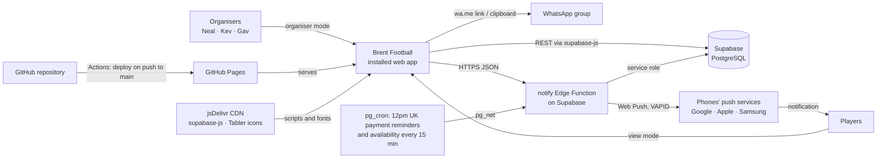
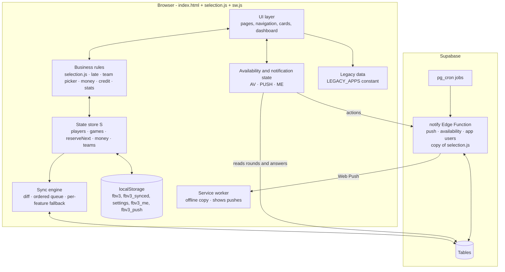
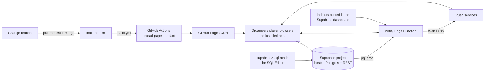
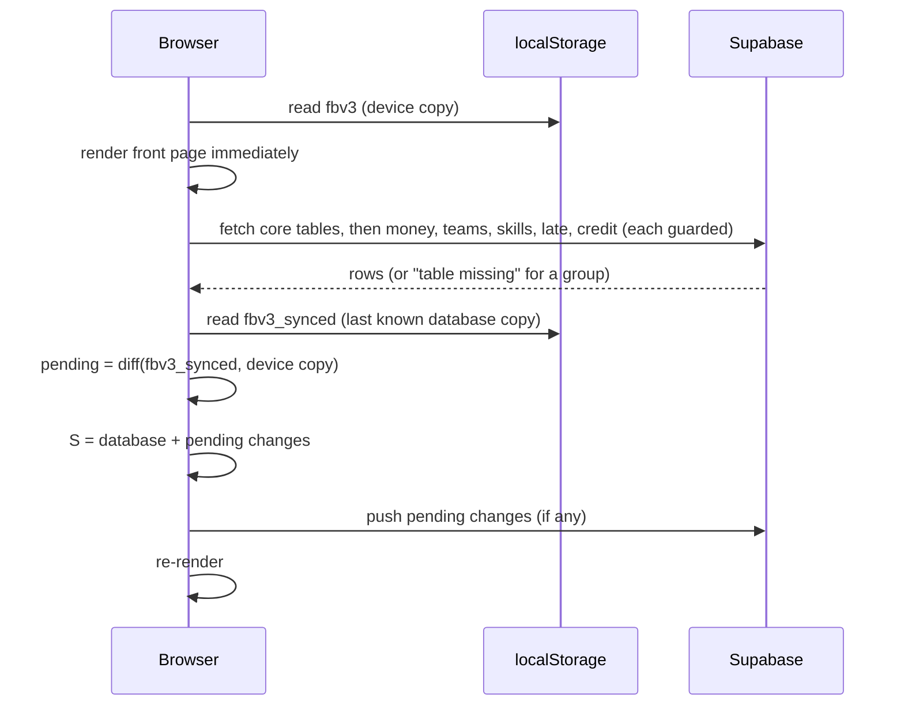
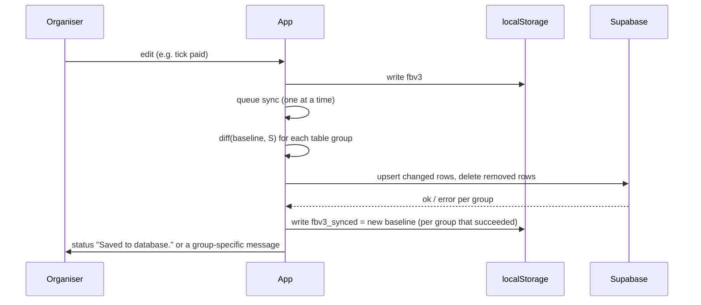
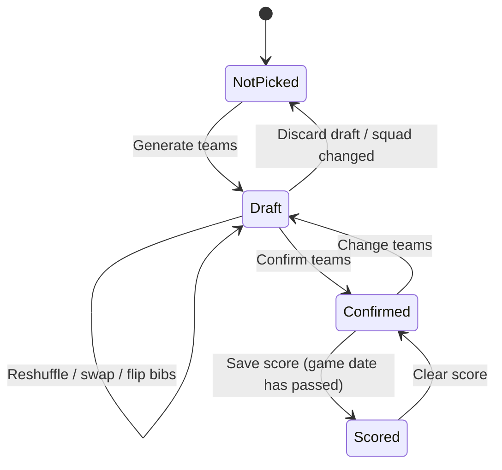
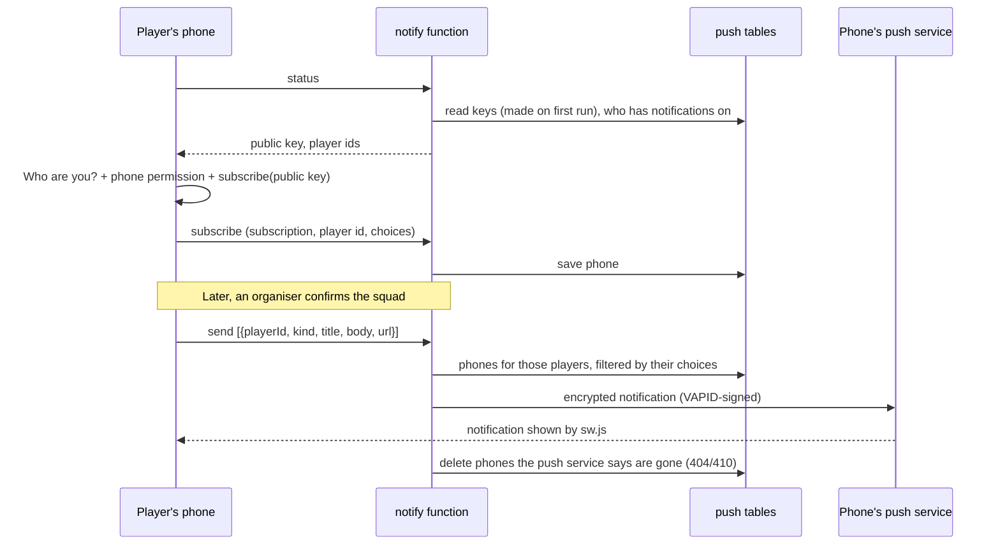
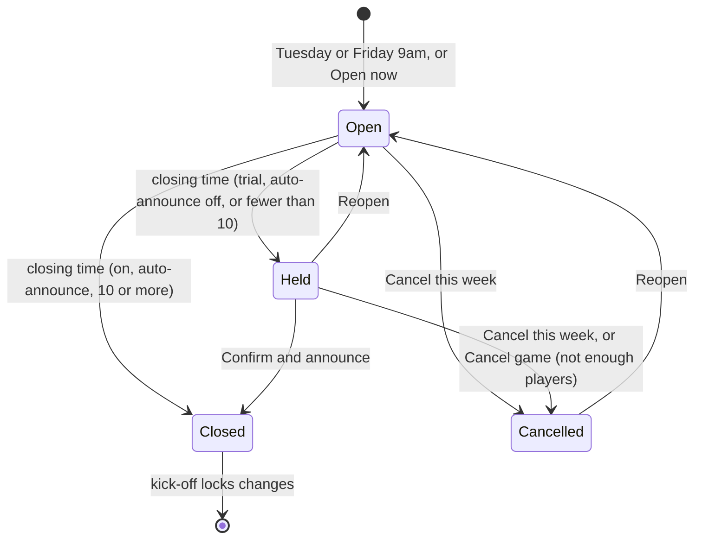
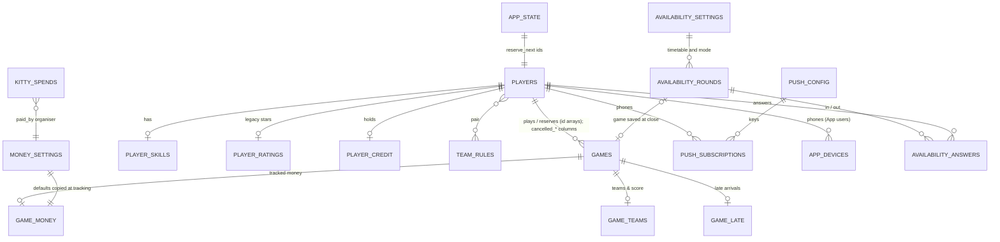

# Brent Football: Solution Design Document

| | |
|---|---|
| **Document** | Solution Design Document (SDD) |
| **Version** | 4.0 |
| **Release** | Production Release 4.0 |
| **Status** | Approved for production |
| **Date** | 24 October 2026 |
| **System** | Brent Football: the web app (`index.html`, `selection.js`, `sw.js`) on GitHub Pages, the Supabase database, the `notify` Edge Function and two scheduled jobs |
| **Repository** | `nealpatel87np/FootballApp` |
| **Companion document** | [`docs/SYSTEM_SPEC.md`](SYSTEM_SPEC.md): page-by-page functional specification |

---

## Contents

1. [Document control](#1-document-control)
2. [Introduction](#2-introduction)
3. [Business context](#3-business-context)
4. [Requirements](#4-requirements)
5. [Solution overview](#5-solution-overview)
6. [Architecture](#6-architecture)
7. [Component design](#7-component-design)
8. [Data design](#8-data-design)
9. [Integration design](#9-integration-design)
10. [Security design](#10-security-design)
11. [User experience design](#11-user-experience-design)
12. [Non-functional design](#12-non-functional-design)
13. [Environments, deployment and release](#13-environments-deployment-and-release)
14. [Testing](#14-testing)
15. [Operations and support](#15-operations-and-support)
16. [Design decisions](#16-design-decisions)
17. [Risks, issues and constraints](#17-risks-issues-and-constraints)
18. [Future roadmap](#18-future-roadmap)
19. [Appendices](#19-appendices)

---

## 1. Document control

### 1.1 Versioning policy

This document and the application share one version number, **MAJOR.MINOR**.

| Change | Version | Examples |
|---|---|---|
| **Visual only** | No new version | Wording or labels, layout, colours, removing a figure from a card. The version stays the same; affected sections are still updated (decided 26 Oct 2026). |
| **Minor adjustment** | 1.0 → 1.1 → 1.2 | A new feature, an extra column, a small rule change, bug fixes, legacy data corrections |
| **Major overhaul** | 1.x → 2.0 | A new page or workflow, a change to squad, team or money logic, new or restructured database tables, new hosting or database |

If a change only alters how something looks, it gets **no new version**. If you aren't sure, treat the change as **minor** unless it changes the data model (section 8) or a core rule (section 7.4).

### 1.2 Change procedure

1. **Agree the change.** A mock-up or preview is produced for anything visual.
2. **Build and test it** on a working branch, at phone width (375–390px) and desktop width (1280px), with the database blocked so live data is never touched in testing.
3. **Update this document for every release, however small.** Change the version, add a revision history row, and update every section the change affects. Do this in the same pull request as the change. Also update [`SYSTEM_SPEC.md`](SYSTEM_SPEC.md), the README's current release and `APP_VERSION`. The repository's `CLAUDE.md` records this rule for future sessions.
4. **Merge** the pull request into `main`. GitHub Pages deploys automatically.
5. **Tag** the merge commit `vMAJOR.MINOR` on GitHub (*Releases → Draft a new release*).
6. **Run any new SQL file** once in Supabase (section 13.3).

### 1.3 Revision history

| Version | Date | Author | Summary |
|---|---|---|---|
| 1.0 | 22 Oct 2026 | Organisers with Claude Code | First production release. Baseline design for every feature in the app at that date. |
| 1.1 | 23 Oct 2026 | Organisers with Claude Code | Added explicit Data API `grant` statements to every SQL script, after Supabase's change to grants for new tables (30 Oct 2026). New tables must include them (13.3). No app change. |
| 1.2 | 23 Oct 2026 | Organisers with Claude Code | Installable app: named **Brent Football** (page title and heading), with app icon, web app manifest and service worker for home-screen install and opening offline. |
| 1.3 | 24 Oct 2026 | Organisers with Claude Code | **Availability message** card on Run game (hidden until Show) builds the pre-game WhatsApp availability message for Monday or Thursday (19.1). No data change. |
| 2.0 | 24 Oct 2026 | Organisers with Claude Code | **Push notifications** (7.5): "Who are you?" opt-in, Notifications page with per-type choices, squad, teams, payment-reminder and credit-used notifications, daily automatic reminders. New `notify` Edge Function, two new closed tables (`push_subscriptions`, `push_config`) and a schedule. |
| 2.1 | 24 Oct 2026 | Organisers with Claude Code | The daily reminder schedule now sends the publishable key, because Supabase only lets requests reach the function with the project's key. Re-run `push-cron.sql`. |
| 2.2 | 24 Oct 2026 | Organisers with Claude Code | Setup page shows organisers whether notifications are connected, and why not (function unreachable, wrong code deployed, or the error it returned). |
| 2.3 | 24 Oct 2026 | Organisers with Claude Code | Turning notifications on gives up with a clear message at whichever step stalls (permission, background helper, the phone's push service, saving the phone) instead of waiting on "Turning on…". Registers the service worker if it's missing. |
| 2.4 | 24 Oct 2026 | Organisers with Claude Code | Front page shows the app version (`APP_VERSION`). Turning on shows each step as it happens. Permission works with older callback-style browsers. The service worker fetches the app's own files with `no-cache`, so a release isn't held back by GitHub Pages' 10-minute browser cache. |
| 2.5 | 24 Oct 2026 | Organisers with Claude Code | Delivery checks on the Notifications page: the service worker tells an open app when a push arrives (and whether it was shown), **Show one on this phone** displays a local notification, and the page shows the phone's push service and the version. The test reports how many phones it was sent to. |
| 2.6 | 24 Oct 2026 | Organisers with Claude Code | Notifications use `renotify` and a vibration pattern, so a repeat with the same tag still alerts. Runbook covers Samsung showing site notifications silently. |
| 2.7 | 24 Oct 2026 | Organisers with Claude Code | Status bar badge (`icons/badge-96.png`, white football) on every notification. In Samsung Internet, the Get notified card and the Notifications page advise installing from Chrome, with an **Open in Chrome** link (Android intent). Samsung Internet delivered pushes but the phone didn't pop them up; Chrome works. |
| 3.0 | 24 Oct 2026 | Organisers with Claude Code | **Self-service availability** (7.6): players say in or out, availability opens and closes on a timetable, and the squad is picked and saved automatically with the shared selection rules (`selection.js`). It sits behind an Off / Trial / On switch (off by default). **App users** page for organisers. New tables `availability_settings`, `availability_rounds`, `availability_answers`, `app_devices`. A 15-minute schedule. New Availability notification type. First-time welcome, install and "Who are you?" cards. |
| 3.1 | 24 Oct 2026 | Organisers with Claude Code | Supabase refused to bundle the function because it imported `selection.js` from the website. The rules are now copied into the function between `BEGIN selection.js` and `END selection.js` markers, and the file is self-contained again. |
| 3.2 | 24 Oct 2026 | Organisers with Claude Code | **Organiser dashboard** (7.7), the first page after logging in. It has: Next game, To do, Money, Recent answers, The group, Turnout and This season. It's a grid on computers and one column on phones. The organisers' phone bar becomes Dashboard, Run game, Teams, Payments and More. No database change. Full review of this document for 3.2: earlier sections brought up to date (scope, constraints, architecture, data, security, operations, roadmap, defaults and glossary). |
| 3.3 | 24 Oct 2026 | Organisers with Claude Code | Dashboard layout. On computers: To do and The group on the left beside Next game (and Recent answers); Money, a new **League** table and This season in one row; Turnout across the full width with reserves stacked on each bar. Cards in a row are the same height, and the league shows as many rows as fit its row. To do groups missing scores and untracked money into one line each. Document reviewed for 3.3 (requirements, modules, capability map, defaults, decisions, glossary). |
| 3.4 | 24 Oct 2026 | Organisers with Claude Code | App users page: the "Seen" column is removed, as organisers didn't need it. Players with the app are listed first, then by name. The check-in still records a last-seen time in `app_devices`, but nothing shows it. |
| 3.5 | 25 Oct 2026 | Organisers with Claude Code | The welcome install card shows to anyone using the app in a browser, whatever the availability switch (it was On only), until dismissed or installed. The Notifications page always has an **Install the app** section until the app is installed. The Install app button is hidden on iPhone and Samsung Internet, which get steps instead. Installing hides both. The change procedure (1.2) now requires this document to be updated for every release, and `CLAUDE.md` records the rule. |
| 3.6 | 25 Oct 2026 | Organisers with Claude Code | **Automatic payment reminders** now go out **every day at 12pm UK time** to anyone who still owes on any tracked game, until they've paid. Each player gets one message with the total, the games and who to pay. This replaces the reminder the morning after a game. The schedule now calls at 11:00 and 12:00 UTC, and the function only sends at 12 o'clock UK time, so summer time is handled. Re-run `push-cron.sql` and redeploy the function. |
| 3.7 | 25 Oct 2026 | Organisers with Claude Code | **Personal greeting** (7.8): a phone that has picked Who are you? shows "Hi {name} 👋" with chips on the front page. Players see their next game, what they owe and their credit; while availability is open, whether they've said in. Organisers on the Dashboard see the time of day, their to-do count and how many are in. **Not you?** changes the name. No database change. |
| 3.8 | 25 Oct 2026 | Organisers with Claude Code | **Lower Supabase traffic** (12, 13.3): the app re-reads availability every 30 seconds only while a round is open, every 5 minutes otherwise, and straight away when it comes back on screen. The availability schedule runs from 07:00 to 22:45 UTC instead of all day (64 calls a day, down from 96), so opening and closing times must be between 8am and 10:45pm UK time, which Setup checks. A nightly job deletes schedule history older than 7 days. New `supabase/schedule-3.8.sql`, run by hand; no function change. |
| 3.9 | 26 Oct 2026 | Organisers with Claude Code | **Simpler dashboard and cancelled games** (7.4.7, 7.7): Turnout shows only each game's numbers (no averages, short or late counts), and Money no longer lists who owes most. A game with fewer than 10 playing counts as **cancelled**: it isn't asked for money, a score or late arrivals on To do, and Payments keeps it behind **Show paid and cancelled games** with **Track anyway**. Page only. |
| 4.0 | 26 Oct 2026 | Organisers with Claude Code | **Cancel a game** (7.4.10, 7.6.3, 7.9): organisers can cancel a saved game (Drop-outs, Pitch not available, Weather or Other, with an optional note) from the Dashboard, Run game or Game Log, and Undo it. Run game offers **Cancel game: not enough players** when fewer than 10 are picked. Availability that closes with fewer than 10 is **held** for organisers to cancel, keep open or confirm anyway. Cancelled games stay in the Game Log but don't count towards games played, reserves, attendance, the league or late arrivals, and need no money. Players get a "game is cancelled" notification and the front page says the game is off. Major: new `games` columns (`cancel.sql`) and changed squad and availability logic; the `notify` function changes. |
| 4.0 (update) | 31 Oct 2026 | Organisers with Claude Code | No version change, at the organisers' request. **Payments privacy** (10.1, 10.3): in View mode Payments shows only the player's own balance; organisers see everything. **Availability window** (7.6.3): once closing time passes, players can no longer say they're in, whether the round is still open (before the 15-minute close runs), held or closed. They can still drop out. Organisers can still add a player (Answer for a player, Run game, Game Log), and **Keep it open** lets players in again. The `notify` function refuses the answer, so it has to be redeployed. |

### 1.4 Approval

| Role | Name | Decision |
|---|---|---|
| Product owner and organiser | Neal | Approved release 1.0, and each later release up to 3.2 when it was deployed |
| Organiser | Kev | |
| Organiser | Gav | |

---

## 2. Introduction

### 2.1 Purpose

This document describes **how** Brent Football (first released as the Football Organisation App) is designed and built: its architecture, components, data, integrations, security, and how it's deployed and supported. It's the reference for anyone changing, running or reviewing the system.

### 2.2 Scope

**In scope:**
- the web app (`index.html`, the shared selection rules in `selection.js`, the service worker `sw.js`, the manifest and icons), installable on phones as Brent Football
- the Supabase database, the `notify` Edge Function, and the two scheduled jobs (daily payment reminders, 15-minute availability check)
- its build and deployment pipeline (GitHub Pages)
- the SQL setup scripts in `supabase/`
- appearance data brought over from the old spreadsheet

**Out of scope:**
- the unrelated starter app in the same repository (`server.js`, `public/`, SQLite)
- venue booking
- online payment processing
- player accounts and sign-in (players pick their name with "Who are you?")
- app store versions (the app is installed from the browser)
- travel and weather updates (mocked up in October 2026, deferred; see the roadmap)

### 2.3 Audience

- **Organisers**, who run the group and approve changes.
- **Anyone maintaining the code.**

### 2.4 References

| Reference | Location |
|---|---|
| Functional specification | `docs/SYSTEM_SPEC.md` |
| User guide | `README.md` ("Football organisation page") |
| Database setup scripts | `supabase/*.sql` |
| Edge Function | `supabase/functions/notify/index.ts` |
| Deployment workflow | `.github/workflows/static.yml` |

### 2.5 Definitions

See the glossary in Appendix 19.5.

---

## 3. Business context

### 3.1 Background

The group plays twice a week, on **Monday** and **Thursday** evenings, typically 5-a-side or 6-a-side with up to 12 players. Three organisers (Neal, Kev, Gav) take turns running games, collecting £8.50 per player and paying for the pitch (£80). Any surplus goes into a shared **kitty**, spent on footballs, kit and socials.

Until October 2026 this was all managed in a spreadsheet, a WhatsApp availability poll and manual WhatsApp messages. That made it hard to:
- be fair about who gets a place when more than 12 want to play;
- balance teams;
- track who has paid and who owes;
- keep history;
- reach players quickly when the squad, teams or money changed.

### 3.2 Objectives

| ID | Objective |
|---|---|
| OBJ-1 | Pick each squad fairly and consistently, honouring guaranteed places, reserve promises and penalties for lateness. |
| OBJ-2 | Produce balanced teams quickly, close to kick-off. |
| OBJ-3 | Generate WhatsApp messages in the group's usual format with one tap. |
| OBJ-4 | Know at any time who owes money, how much is in the kitty and who holds it. |
| OBJ-5 | Keep a long-term record of games, scores, appearances and statistics, including the spreadsheet history. |
| OBJ-6 | Work well on a phone, cost nothing to run and need no server administration. |
| OBJ-7 | Tell players what affects them (picked, team, money owed) directly on their phone, and let them say whether they're playing without an organiser collecting answers. |
| OBJ-8 | Give organisers one place that shows what needs doing. |

### 3.3 Stakeholders

| Stakeholder | Interest |
|---|---|
| Organisers (Neal, Kev, Gav) | Run games, manage money, maintain data. Full access. |
| Players | See the next game, teams, stats and what they owe; say in or out for the next game (when self-service availability is On); choose their notifications. Otherwise read-only. |

### 3.4 Success measures

- A squad and its WhatsApp message take under two minutes.
- Teams take under one minute.
- Outstanding money is visible at a glance.
- No double counting between the spreadsheet history and the app.
- With self-service availability On, the squad is announced at closing time with no organiser work.

---

## 4. Requirements

### 4.1 Functional requirements

| ID | Requirement | Priority | Section |
|---|---|---|---|
| FR-01 | Maintain a player list with availability (Monday, Thursday or both), preferred day and guaranteed lists for each day. | Must | 7.4.1 |
| FR-02 | Pick a squad of up to 12 for a Monday or Thursday game from the available players, using the defined selection order. Extra players become reserves. | Must | 7.4.1 |
| FR-03 | Give last game's reserves a guaranteed place next game. | Must | 7.4.2 |
| FR-04 | Let organisers mark late arrivals, and place late players after non-guaranteed players at their next game. | Must | 7.4.3 |
| FR-05 | Rate players 1–10 on Attack, Defence, Fitness and Goalkeeping, with an auto or manual position and a regular keeper flag. | Must | 7.4.5 |
| FR-06 | Generate balanced teams, honouring keep-apart and same-team rules, spreading regular keepers evenly and balancing keepers. A coin flip decides the bibs. | Must | 7.4.4 |
| FR-07 | Hold teams as a shared draft until confirmed. Show confirmed teams on the front page. | Must | 7.3.4 |
| FR-08 | Produce availability, squad and teams WhatsApp messages in the group's format, with copy and open-in-WhatsApp. | Must | 19.1 |
| FR-09 | Record the score of each game with confirmed teams. | Must | 7.4.6 |
| FR-10 | Show player statistics (played, won, drawn, lost, win %) from scored games only. | Must | 7.4.6 |
| FR-11 | Show attendance (appearances by year, total, times in reserve) to organisers, including spreadsheet history, without affecting any other logic. | Must | 7.4.9 |
| FR-12 | Track each game's money on request: organiser, who paid, the split between pitch, admin and kitty. | Must | 7.4.7 |
| FR-13 | List outstanding payments by player and game, with Clear per game and per player, linked to the game's paid ticks. | Must | 7.4.7 |
| FR-14 | Hold player credit and apply it automatically to future games. | Should | 7.4.8 |
| FR-15 | Keep a kitty ledger with spends, starting balances and each organiser's holdings. | Must | 7.4.7 |
| FR-16 | Read-only View mode for players. Organiser mode behind a password. | Must | 10 |
| FR-17 | Export and import all data, and export a CSV game log. | Should | 7.3.9 |
| FR-18 | Show the next game, its teams or squad, and the kitty on a front page. | Must | 7.3.1 |
| FR-19 | Let each player turn on push notifications on their phone and choose which kinds they get. Notify players when the squad or teams are confirmed, when they owe money (by organiser, and automatically every day at 12pm until paid) and when credit is used. | Should | 7.5 |
| FR-20 | Behind an organiser switch (Off / Trial / On), let players say in or out for the next game in the app, open and close availability on a timetable, and pick, save and announce the squad automatically with the Run game rules. Handle drop-outs and late joiners until kick-off. | Should | 7.6 |
| FR-21 | Show organisers which players have set up the app, on which browser, and which notifications they have on. | Should | 7.6.4 |
| FR-22 | Give organisers a dashboard of what needs doing, the next game, money, the group, a league table for the year, turnout (with reserves) and this season, with a button to each job. | Should | 7.7 |
| FR-23 | Greet a phone's player by name on the front page (and organisers on the Dashboard), with what matters to them now: playing or reserve, availability answer, money owed and credit. | Could | 7.8 |
| FR-24 | Let organisers cancel a game (from Run game when fewer than 10 are in, or later for drop-outs, pitch or weather), tell the players, keep it on record without counting it or charging for it, and undo it. | Must | 7.4.10, 7.9 |

### 4.2 Non-functional requirements

| ID | Requirement |
|---|---|
| NFR-01 | **Usability:** mobile-first. Works from 375px wide with no sideways scrolling. Phone navigation within thumb reach. |
| NFR-02 | **Availability:** opens and shows the last data even when the database is unreachable. Changes made offline are sent later. |
| NFR-03 | **Data integrity:** a device with stale data must never delete rows it hasn't seen. Concurrent edits resolve per row. |
| NFR-04 | **Cost:** no running costs. Free tiers of GitHub Pages and Supabase. |
| NFR-05 | **Maintainability:** no build step. Plain JavaScript in one page (`index.html`) plus the shared `selection.js`; one small server function. |
| NFR-06 | **Resilience to setup gaps:** each feature's data degrades to device-only storage if its table hasn't been created, without breaking other features. |
| NFR-07 | **Performance:** team generation feels instant for squads of up to 14, and stays reasonable up to 20. |
| NFR-08 | **Accessibility:** labelled controls, visible focus, reduced motion respected, light and dark themes. |

### 4.3 Constraints

- The web app is static (GitHub Pages). Server-side logic is limited to one Supabase Edge Function (`notify`) and two `pg_cron` jobs, all on Supabase's free tier.
- The database is accessed directly from the browser with a public (publishable) key. The function uses the service role, which only Supabase holds.
- The function is deployed by pasting its code into the Supabase dashboard, so it must be one self-contained file (no imports from other websites).
- Organisers may edit on different phones at the same time.

### 4.4 Assumptions

- The group stays small: under about 150 known players and around 100 games a year.
- The organisers are trusted. Players are honest viewers.
- The squad size of 12 and the twice-weekly pattern are stable.

---

## 5. Solution overview

### 5.1 Approach

The solution is a **single-page web application** served as static files and installable on phones, using **Supabase** (hosted PostgreSQL with an auto-generated REST API) as the shared data store. Every device keeps a full copy of the data in `localStorage` and syncs changes to Supabase row by row.

Most business logic runs in the browser. The **`notify` Edge Function** on Supabase does the jobs that can't: it holds the notification keys and sends Web Push notifications, runs the self-service availability timetable (opening, the 9pm close, drop-outs and late joiners), and lists app users. Two `pg_cron` jobs call it on a schedule. The squad selection rules live in `selection.js`, with an exact copy inside the function, so the browser and the server always pick the same squad.

### 5.2 System context



### 5.3 Capability map

| Capability | Pages |
|---|---|
| Organiser overview | Dashboard |
| Player management | Setup, Ratings, App users |
| Game day | Run game, Teams, Availability (self-service) |
| Communication | Push notifications (Notifications page), WhatsApp cards on Run game, Teams and Game Log |
| Records and insight | Game Log, Player Stats, Attendance, the Dashboard's League, Turnout and This season |
| Finance | Payments (Outstanding Payments, Credit, Kitty, Games, Ledger, Split settings) |
| Access | Front page (with first-time welcome and Who are you?), View mode, Log in |

---

## 6. Architecture

### 6.1 Logical architecture



### 6.2 Technology stack

| Layer | Technology | Version or notes |
|---|---|---|
| Presentation | HTML5, CSS (custom properties, grid, flexbox), vanilla JavaScript (ES2020) | `index.html` (about 3,950 lines) and `selection.js` (shared squad rules) |
| Icons | Tabler Icons web font | `@tabler/icons-webfont@2.44.0` (jsDelivr) |
| Data client | `@supabase/supabase-js` | v2 (jsDelivr UMD build) |
| Database | Supabase (PostgreSQL 15+) with PostgREST | Row Level Security on, open policies |
| Local persistence | Web Storage (`localStorage`) | Full data copy and the sync baseline |
| Installable app | Web app manifest (`manifest.webmanifest`), service worker (`sw.js`), icons (`icons/`) | Home-screen install as Brent Football; network first, cached copy when offline |
| Server logic | Supabase Edge Function `notify` (Deno, TypeScript, about 520 lines; `web-push@3.6.7`, `supabase-js@2`) | Free tier. Deployed by pasting into the dashboard; Verify JWT off |
| Notifications | Web Push (VAPID) through the phone's push service | Free |
| Schedules | `pg_cron` and `pg_net`: payment reminders every day at 12pm UK time (called at 11:00 and 12:00 UTC) and the availability check (every 15 minutes, 07:00–22:45 UTC), plus a nightly tidy-up of schedule history | Free tier |
| Hosting | GitHub Pages | Deployed by GitHub Actions on push to `main` |
| Source control | Git or GitHub | Pull request per change |

### 6.3 Physical and deployment architecture



The web app deploys automatically on merge. The function and the SQL scripts are applied by hand in the Supabase dashboard when a release needs them (13.3).

---

## 7. Component design

### 7.1 Module structure (in `index.html` unless noted)

| Module | Responsibility | Key functions |
|---|---|---|
| **Clean records** | Normalise every record loaded from storage, the database or an import | `cleanState`, `cleanPlayer`, `cleanGame`, `cleanMoney`, `cleanTeams`, `cleanSkill`, `cleanLate`, `cleanCredit` |
| **Sync engine** | Load, compare and push changes, with a separate fallback for each feature | `loadState`, `fetchDb`, `diffState`, `applyDiff`, `syncToSupabase`, `save` |
| **Access** | Front page, log in or out, view and edit modes | `renderFront`, `frontLogin`, `enterApp`, `goFront`, `logOut` |
| **Navigation** | Desktop tabs, phone bottom bar, More sheet | `goTab`, `buildNav`, `markNav`, `toggleMore` |
| **Players** | Add, edit, remove, the setup list | `addPlayer`, `saveEdit`, `removePlayer`, `renderPlayers` |
| **Game flow** | Availability, squad build, confirm | `startGame`, `buildSquad`, `renderSquad`, `confirmGame` |
| **Game log** | History, editing a game, manual games, dates, scores | `renderHistory`, `renderLogEntry`, `saveManualGame`, `logSetDate`, `deleteGame`, `scoreSave` |
| **Late arrivals** | Mark and penalise | `toggleLate`, `latePenalty`, `lateIdsOf` |
| **Ratings** | Skills, positions, keepers, team rules | `skillOf`, `posOf`, `overallOf`, `skillSet`, `ruleAdd`, `renderRatings` |
| **Team picker** | Generate, draft, confirm, swap, messages | `pickTeams`, `teamRulesFor`, `keeperScore`, `renderTeamsPage`, `teamsConfirm`, `teamsText` |
| **Stats** | Player stats, attendance, legacy list | `renderStats`, `renderAttendance`, `renderLegacyList`, `legacyOf` |
| **Money** | Tracking, split, kitty, ledger, spends, settings | `gameSplit`, `moneyHoldings`, `moneyTrack`, `renderMoney`, `moneyAddSpend` |
| **Payments** | Outstanding payments and credit (organisers); each player's own balance in View mode | `debtsOwed`, `oweClear`, `creditAdd`, `applyCredit`, `renderOwes`, `renderMyBalance` |
| **WhatsApp** | Availability, squad and teams messages, copy, open | `pollText`, `waText`, `teamsText`, `waCopy`, `teamsCopy`, `waOpen` |
| **Installable app** (`sw.js`, manifest) | Offline copy, fresh files on each release, shows push notifications, opens the right page when tapped | `install`, `fetch`, `push` and `notificationclick` handlers |
| **Server** (`supabase/functions/notify/index.ts`) | Keys and push sending, daily reminders, availability timetable and close, drop-outs and late joiners, app users | `vapid`, `send`, `daily`, `tick`, `openRound`, `closeRound`, `changeAfterClose`, `answerAvail`, `hello`, `adminUsers` |
| **Export and import** | JSON file, share, text, CSV, import | `exportFile`, `exportLogCSV`, `applyImport` |
| **Selection rules** (`selection.js`) | Squad order shared by Run game and the function | `orderSquad`, `splitSquad`, `latePenaltyFor` |
| **Dashboard** | Organiser home page cards | `renderDash`, `dashTodos`, `dashNextCard`, `dashMoneyCard`, `dashGroupCard`, `dashLeagueCard`, `dashFitLeague`, `dashTurnoutCard`, `dashSeasonCard` |
| **Greeting** | "Hi {name}" card under the heading on the front page and the Dashboard | `renderHi`, `hiChips`, `hiNotYou` |
| **Cancelled games** | Cancel dialog, cancelled boxes, Run game's under-10 step, the cancelled WhatsApp message and notifications | `cancelOpen`, `cancelGame`, `cancelUndo`, `cancelCounts`, `pushCancel`, `cancelWaText`, `runShortUI`, `runCancel`, `avShortButtons`; `gameCancelled`, `realGames` |
| **Availability** | Player card, organiser card, settings, App users | `availLoad`, `avPlayerCard`, `avOrgCard`, `avSettingsCard`, `avAnswer`, `avAct`, `avHello`, `renderUsers`, `availRender` |
| **Notifications** | Opt-in, choices, sending, front card, Notifications page | `pushLoadStatus`, `pushTurnOn`, `pushUpdate`, `pushTurnOff`, `pushSquad`, `pushTeams`, `pushRemind`, `pushCreditUsed`, `renderNotify`, `renderPushCard` |

### 7.2 State model

All data lives in one in-memory object, `S`:

```text
S = {
  players:     [ {id, name, avail, pref, guarMon, guarThu, played, reserved, lastPlayed} ],
  games:       [ {id, date, day, iso, manual, playingIds[], reserveIds[]} ],   // sorted by iso, then id
  reserveNext: [ playerId ],
  money: { settings{price,pitch,adminPct}, opening{Neal,Kev,Gav},
           games[{gameId,org,price,pitch,adminPct,paidIds[]}], spends[...], credit[{playerId,amount}] },
  teams: { ratings[...], rules[...], games[{gameId,t1[],t2[],bibs,status,score1,score2}],
           skills[{playerId,att,def,fit,gk,pos,keeper}], late[{gameId,ids[]}] }
}
```

Every change follows the same pattern: update `S`, call `save()`, then re-render the affected view.

### 7.3 Key flows

#### 7.3.1 Opening the app



#### 7.3.2 Saving a change



#### 7.3.3 Game day

```mermaid
flowchart LR
  A[Run game:<br/>organiser + day] --> B[Tick available]
  B --> C[Pick squad<br/>selection rules]
  C --> D[Squad WhatsApp]
  D --> E[Confirm game]
  E --> F[Teams: generate<br/>draft · reshuffle · swap]
  F --> G[Teams WhatsApp]
  G --> H[Confirm teams<br/>shows on front page]
  H --> I[Game played:<br/>mark late · enter score]
  I --> J[Payments: Track money<br/>credit applied]
  J --> K[Tick paid / Clear<br/>until all paid]
```



With self-service availability **On**, the first five steps happen without an organiser: availability opens on Tuesday or Friday, players say in or out, and at 9pm the function picks, saves and announces the squad (7.6). The flow then continues from Teams.

#### 7.3.4 Team lifecycle



### 7.4 Business rules

#### 7.4.1 Squad selection

Players ticked as available are sorted, and the first **12** play:

1. on the guaranteed list for that day;
2. carried over from last game's reserves (`reserveNext`);
3. **not** carrying a late penalty, so late players go after everyone else;
4. available only on this day, then preferring this day, then the rest;
5. most times in reserve first;
6. (self-service availability only) whoever said in first.

The rules are in `selection.js`, used by Run game and the availability preview, and copied exactly into the `notify` function for the 9pm close. Organisers can move players by hand before confirming.

#### 7.4.2 Reserve guarantee

`reserveNext` is set to the reserves of a confirmed game. Changes to the latest game's squad update it. Deleting the latest game restores the previous game's reserves.

#### 7.4.3 Late penalty

```text
latePenalty(p) = p marked late in game G
                 AND no later game includes p (playing or reserve)
```

#### 7.4.4 Team picker

```text
for each split (A, B) with |A|-|B| ≤ 1:
    reject if a keep-apart pair is together, a same-team pair is split,
           or (regular keepers K ≥ 2 and |2·keepers(A) − K| > 1)
    cost = |ΣAtt(A)−ΣAtt(B)| + |ΣDef(A)−ΣDef(B)| + |ΣFit(A)−ΣFit(B)|
         + 2·|keeperScore(A) − keeperScore(B)|
keeperScore(T) = max GK of T's regular keepers, else max GK of all of T
pick at random among minimum-cost splits (never the current teams; widen by 1 if needed)
Team 1 = coin flip; bibs = coin flip
```

- **Search size:** every split is checked up to 20 players (C(20,10) = 184,756). Above 20, a random sample of 20,000 splits is used.
- If no split satisfies the rules, the rules are relaxed to balance only.

#### 7.4.5 Skills

- Overall = (Att + Def + Fit) / 3.
- Auto position: Defender if Def − Att ≥ 2, Striker if Att − Def ≥ 2, otherwise Anywhere.
- Players with no saved skills start from their old 1–5 stars × 2 for each skill. Goalkeeping starts at 7 for players who were ticked as keepers, otherwise 5.

#### 7.4.6 Scores and statistics

- A score can be entered for confirmed teams on a game dated today or earlier.
- Player Stats counts only scored games: Played = W + D + L, and Win % = W / Played.
- Sorted by Played, then Wins, then name.

#### 7.4.7 Money

All amounts are in pence.

```text
collected = paid × price
surplus   = collected − pitch
admin     = surplus > 0 ? round(surplus × admin% / 100) : 0
toKitty   = surplus − admin            (negative = shortfall from the kitty)
owed      = unpaid × price
kitty(org) = opening(org) + Σ toKitty of games org organised − Σ spends org paid
```

- **Tracking is opt-in per game.** Price, pitch cost and admin % are copied onto the game when tracking starts, so later setting changes don't rewrite history.
- **Outstanding Payments** is derived from tracked games' unpaid players. Clearing a debt ticks the player as paid.
- The Games list hides fully paid games behind **Show paid games**.
- **Cancelled games (3.9):** a game with fewer than 10 playing (`MIN_PLAYERS`, `gameCancelled`) was cancelled, so no money is collected. It isn't listed as waiting for money, and the button becomes **Show paid and cancelled games**. There it reads "Game cancelled · only N" (4.0 wording), with **Track anyway** in case it went ahead. Games an organiser cancels (4.0) read "Game cancelled · {reason}" with no Track button (7.4.10). The Dashboard doesn't ask for its money, score or late arrivals.

#### 7.4.8 Credit

- **Adding credit:** (new amount + existing credit) pays off the player's oldest unpaid games, whole games only. The remainder is kept.
- **When a game's money is tracked:** each player with credit ≥ price is marked paid, and the price is deducted from their credit.
- Credit isn't counted in the kitty until it pays for a game.

#### 7.4.9 Legacy appearances

- `LEGACY_APPS` holds `[name, before2026, 2026BeforeApp]`. The 2026 figures exclude games from 8 Oct 2026 onwards, which are recorded in the app.
- **Attendance:**
  - Before 2026 = legacy
  - 2026 = legacy 2026 + app games dated 2026
  - each later year = app games only
  - Total = the sum of all of these
- **Matching:** figures are matched by player name, ignoring capitals.
- **Read-only:** the legacy figures are only read when rendering Attendance. They are never written to `S` or the database.

#### 7.4.10 Cancelled games (release 4.0)

- **Cancelled** means either:
  - an organiser cancelled it: `g.cancelled = { reason, note, by, at }`, saved in the `cancelled_*` columns of `games`;
  - or, automatically, a game with fewer than **10** playing whose money was never tracked (3.9). Tracking its money ("Track anyway") means it went ahead.
- **Reasons:** `players` (Not enough players, set by Run game and availability), `dropouts`, `pitch`, `weather`, `other`. The optional note (up to 140 characters) replaces the standard sentence in messages.
- **What cancelling does** (`cancelGame`):
  - takes one off each player's games played (squad) and times reserved (reserves), and moves "last played" back to their last game that went ahead;
  - removes any money tracking for the game (nobody pays until the day, so there is nothing to refund);
  - if it's the latest game, sets `reserveNext` to the last real game's reserves plus this game's reserves, so nobody loses their place;
  - tells everyone in the game, plus anyone who dropped out of it through availability (`squad` notifications), if the organiser leaves **Send a notification** on.
- **Not counted anywhere:** games played and reserves, Attendance, Player Stats, the league, This season, and the late rule (`realGames()` is used for all of these, in the page and the function). No late marks can be added to it.
- **Undo** (`cancelUndo`) clears the columns, adds the counts back, restores `reserveNext` to this game's reserves if it's the latest, and tells everyone it's back on. Money tracking isn't restored, because there was none to restore.
- **Run game:** with fewer than 10 picked, **Confirm game** becomes **Cancel game: not enough players**. It saves the game as cancelled, with that reason, and sends the cancelled notification instead of "squad is out". **Confirm game anyway with N** keeps the old behaviour.

### 7.5 Push notifications (release 2.0)

#### 7.5.1 Overview

Players get notifications on their phones through the standard **Web Push** system, with no app store. It works on:
- Android: Chrome, Samsung Internet and other browsers;
- iPhone (iOS 16.4 or later), when Brent Football has been added to the Home Screen.

Three parts work together:

| Part | Where | Role |
|---|---|---|
| Page | `index.html` | "Get notified" card, Notifications page, and the organiser's send points |
| Service worker | `sw.js` | Shows each notification and opens the app on the right page when it's tapped |
| `notify` Edge Function | `supabase/functions/notify/index.ts` (Deno, on Supabase) | Holds the notification keys, saves phones, encrypts and sends notifications, and runs the daily reminder |

**Identity:** each phone is linked to one player through "Who are you?". There's no sign-in (ADR-15).

#### 7.5.2 Turning on and sending



#### 7.5.3 Notification types

| Kind | Sent when | Default | Text |
|---|---|---|---|
| `squad` | Organiser confirms a game with **Notify the squad** ticked (on by default) | On | Playing: "⚽ Monday squad is out: You're playing. Mon 26 Oct, 6:30 PM, Harrow Powerleague." Reserves: "You're a reserve this time. You're first in for the next game." |
| `teams` | Organiser confirms teams with **Notify the players** ticked (on by default) | On | "👕 Teams are out: You're on Team 2 (bibs). Kick-off 6:30 PM." |
| `payments` | Organiser taps **Send reminders** on Outstanding Payments; also automatically every day at 12pm UK time to anyone who still owes on any tracked game (`push-cron.sql`) | On | "💷 Payment due: You owe £8.50 for Mon 26 Oct. Pay Kev." Several games are listed, with each organiser's share when more than one. |
| `credit` | A game's money starts being tracked and the player's credit pays for it | Off | "💷 Credit used: £8.50 of your credit paid for Mon 26 Oct. £11.50 left." |
| `test` | Player taps **Send a test notification** | Always | "Test notification. You're all set." |

Rules:
- **Recipients:** only players who have notifications on and that kind switched on receive it. The page filters first (it knows which players have notifications on), and the function filters again by each phone's choices.
- **Tapping a notification:** it opens the app. Payment and credit notifications open Payments, even if the app is already open.
- **Daily reminder (3.6):** every day at 12pm UK time. Each player who still owes on any tracked game gets one message covering all their unpaid games, with who to pay. It repeats daily until they've paid (cleared, ticked as paid, or paid by credit), or until they switch payment reminders off. Games whose money isn't tracked aren't included. The schedule calls at 11:00 and 12:00 UTC, and the function only sends when it's 12 o'clock in the UK, so the time is right in summer and winter.
- **Limits:** the function sends at most 200 messages per call. It clips titles to 80 characters and bodies to 300. Links must be relative to the app (`./…`).
- **Not set up:** if the function isn't deployed, the Notifications page, the front card and all send options stay hidden.
- **Availability (3.0):** an `availability` kind (on by default) covers availability opening, nudges, playing or reserve at the close, promotions, late joins and cancellations.

### 7.6 Self-service availability (release 3.0)

#### 7.6.1 Overview

Players say whether they're in for the next game in the app. At closing time, the squad is picked automatically using the Run game rules.

**The switch** (Setup → Self-service availability, saved in `availability_settings.mode`):

| Mode | Who sees it | Notifications | At closing time |
|---|---|---|---|
| `off` (default) | Nobody. Everything works as in 2.x. | None | Nothing |
| `trial` | Organisers only (logged-in devices) | Only to the organisers' own player ids (`organiser_ids`) | Always held for an organiser to confirm |
| `on` | Everyone | Everyone with the Availability choice on | Saved and announced, unless **Announce automatically** is off (then held) |

**Timetable** (UK time; organisers can change it in the settings):
- Thursday games open on **Tuesday** at 09:00 and close at 21:00 the same day.
- Monday games open on **Friday** at the same times.
- A `pg_cron` job calls `avail_tick` every 15 minutes from 07:00 to 22:45 UTC (since 3.8). The function works out UK time itself, so British Summer Time is handled. The window covers 8am to 10:45pm UK time all year, so opening and closing times must be in it; Setup refuses times outside it.
- Organisers can **Open now** early. A round opened early still closes at the scheduled time.

#### 7.6.2 Round lifecycle



#### 7.6.3 Rules

1. **Everyone must say in.** That includes guaranteed players: no answer counts as out. Saying in puts guaranteed players at the front.
2. **The close** (it runs only once: the status change to closed or held happens first):
   1. Take the players who said in.
   2. Order them with `selection.js`, the same rules as Run game (7.4.1). The new tie-break is whoever answered first.
   3. The first 12 play and the rest are reserves.
   4. Save the game as **Confirm game** does: the `games` row, everyone's played and reserve counts and last played date, and `reserve_next`.
   5. Notify everyone.
   6. If a game already exists for that date (made by hand, even a cancelled one), it's kept and nothing is duplicated.
3. **After closing, until kick-off:**
   - **A player in the squad drops out:** the first reserve moves up and is told, and organisers are told. Draft teams are cleared and confirmed teams go back to draft ("Teams need redoing").
   - **A reserve drops out:** they're removed and the others move up.
   - **A late joiner is added by an organiser** (Answer for a player): they go into the squad if it has fewer than 12, otherwise to the end of the reserves.
   - **Players can't say in once the window has closed (4.0 update):** after closing time the function refuses a player's "in" unless the round was reopened after closing time (**Keep it open**). That applies while the round is still open before the 15-minute close runs, while held, and once closed. Saying out (dropping out) is always allowed until kick-off. The app hides **I'm in** and says "Availability closed at 9pm. Contact the organiser if you'd like to play." (`pastClosing` in the function, `avWindowShut` in the page.)
   - **If no reserves are left:** organisers are warned.
4. **Fewer than 10 at closing (4.0):** the squad is **held**, not saved or announced, and organisers are told "only N are in". They choose:
   - **Cancel game: not enough players:** the round is cancelled and everyone who said in is told "Not enough players: only N were available and we need 10. No payment needed."
   - **Keep it open:** reopens it for late joiners. A round reopened after its closing time isn't closed again by the 15-minute check (`opened_at` is set on reopen); organisers close it with **Close now**, which holds it again if it's still short.
   - **Confirm anyway with N:** saves and announces it as before ("we need N more").
   - A saved game the function is updating stops changing once it's cancelled: drop-outs and late joiners are ignored.
5. **Privacy:** late flags and the "if it closed now" order are shown only on organisers' screens. Players see their own status and the names of players who said in.
6. **Identity:** "Who are you?" (`fbv3_me`) is chosen once per phone and shared with notifications. Organisers can answer for any player.

#### 7.6.4 App users

Each phone that has chosen "Who are you?" checks in through `hello` (at most every 6 hours, and whenever its name or notifications change). It sends:
- a random device id;
- whether the app is installed;
- the browser and platform;
- whether notifications are on.

The organisers' **App users** page combines this with `push_subscriptions` (through `admin_users`). For each player it shows:
- whether they've set up the app, and whether it's installed;
- the browser and platform;
- whether notifications are on, and which kinds.

Players with the app are listed first, then alphabetically. The last-seen time is still recorded but isn't shown (removed in 3.4).

### 7.7 Organiser dashboard (release 3.2)

A **Dashboard** page is the first page organisers see after logging in. It only reads data the app already has: no new tables.

**Layout on a computer** (900px wide or more), a three-column grid where cards in the same row are the same height:

```text
| To do       | Next game (2 columns)              |
| The group   | Recent answers (or Next game)      |
| Money       | League          | This season      |
| Turnout (full width)                           |
```

**On a phone:** one column, in the order Next game, To do, The group, Recent answers, Money, League, This season, Turnout.

| Card | Shows | Actions |
|---|---|---|
| **Next game** | **While availability is open or held:** in, out and no-answer counts with a bar; time left; guaranteed players who haven't said in; the squad "if it closed now" (Guaranteed, →Next and Late tags). **Once a squad is saved:** a checklist (squad, teams, money), the squad, and a warning if the teams no longer match. **Otherwise:** when availability opens next. | Nudge, Close now or Confirm and announce, Answer for a player, Pick teams, WhatsApp, Track money, Open now |
| **To do** | Generated from the data: a squad waiting to be confirmed; guaranteed players not in; scores missing for confirmed teams (last 45 days, one line however many games); played games with money not tracked (one line, with the latest and oldest); draft or out-of-date teams for the next game; money owed (total, players, oldest); late arrivals for yesterday's or today's game (optional). Cancelled games (under 10 playing) are left out of the score, money and late items. Shows "All caught up" when empty. | Each item jumps to the page that does it |
| **Money** | Kitty, still owed, credit held; what each organiser holds and is owed (who owes most was removed in 3.9) | Payments; Send reminders (when anyone who owes has notifications on) |
| **Recent answers** | The latest availability answers, including any made by an organiser (only when the switch isn't Off) | |
| **The group** | On the app, notifications on, not yet; who isn't on the app; Samsung Internet users. Comes from `admin_users`, cached for 5 minutes. | App users; Copy invite message |
| **League** | This year's table from confirmed teams with a score: P, W, D, L, goal difference and points (3 for a win, 1 for a draw), ordered by points, then goal difference, then wins. Shows as many rows as fit the height of its row (top 6 on a phone), then "+ N more". | Player Stats |
| **Turnout** | Full width: the last 12 played games as bars, with players at the bottom (cancelled games, under 10, in red) and reserves stacked on top, and each game's numbers above its bar (for example 12+1). A key for Playing, Reserves and Game cancelled. Cancelled games (by an organiser, or under 10) show a red ✕ instead of numbers (4.0). Averages and late counts were removed in 3.9. | |
| **This season** | Most games this year (the app's games plus the spreadsheet's 2026 figures), and best win % with 5+ scored games | |

**Phone bar for organisers:** Dashboard, Run game, Teams, Payments and More. Game Log moves under More. Viewers' pages are unchanged.

### 7.8 Personal greeting (release 3.7)

When a phone has picked Who are you? (`fbv3_me`), a card under the Brent Football heading says **"Hi {name} 👋"**. It's on the **front page** for everyone, and on the **Dashboard** for organisers. It's hidden on every other page, and when no name has been picked.

| Where | Line under the name | Chips (real data) |
|---|---|---|
| Front page | "Here's what's coming up for you.", or "{Day}'s availability is open until {time}." while it's open | **Availability open or held:** You're in / You're out / You haven't said if you're in. **Otherwise, the next saved game:** Playing {day} / {nth} reserve for {day} / Not in {day}'s squad. **Money:** You owe £x (all tracked games), or All paid up. **Credit:** £x credit, if any. |
| Dashboard (organisers) | "Good morning / afternoon / evening. Here's where things stand." (from the phone's clock) | N things to do (same list as To do), or All caught up; and N in for {day} while availability is open |

**Not you?** opens the Notifications page's Not you? if the phone has notifications on, so the name and notifications change together. Otherwise it forgets the name, and Who are you? (or Get notified) asks again.

---

### 7.9 Cancelling a game (release 4.0)

| Where | When | What it shows |
|---|---|---|
| **Run game**, squad step | Fewer than 10 picked | A red "Not enough players" warning, the cancelled WhatsApp message, "Tell the N the game is cancelled", **Cancel game: not enough players**, and a **Confirm game anyway with N** link |
| **Run game**, done step | After cancelling | "Game cancelled: not enough players", who and when, the notification result and **Undo cancel**. The squad and Teams cards are hidden. |
| **Dashboard**, Next game | A saved game | **Cancel game** (red when fewer than 10 are left, with a warning). Once cancelled: the cancelled box with Copy WhatsApp message, Open WhatsApp and Undo cancel. |
| **Dashboard and Run game**, availability held | Fewer than 10 in at closing | **Cancel game: not enough players**, **Keep it open** and **Confirm anyway with N** |
| **Game Log** | Any game | **Cancel game** next to Delete. A cancelled game has a **Game cancelled** badge, its reason, the cancelled box and no late or add-player controls. |
| **Payments** | Cancelled games | Kept behind **Show paid and cancelled games**: "Game cancelled · weather". Only under-10 games get **Track anyway**. |
| **Turnout** | Cancelled games | A red **✕** above the bar, key "Game cancelled" |
| **Front page and availability card** | The next game is cancelled | "✕ {Day}'s game is off", the reason and "No payment needed". The greeting chip says "✕ {Day} cancelled". |

**The cancel dialog** (`<dialog id="cancel-dlg">`) asks for a reason (Drop-outs, Pitch not available, Weather, Other) and an optional note. It shows who will be told and what happens, with a **Send a notification** switch. Nothing changes until **Cancel game** is pressed.

**Notifications** (kind `squad`, tag `squad-{game id}` so they replace the squad notification):
- "❌ {Day}'s game is cancelled": the reason sentence, then "No payment needed."
- "✅ {Day}'s game is back on" after Undo: the time and venue for the squad, and their place for reserves.

## 8. Data design

### 8.1 Entity relationship



Relationships are held as id arrays (`playing_ids`, `paid_ids` and so on) rather than foreign keys. That keeps each game one row and makes the browser diffing simple.

### 8.2 Table definitions

| Table | Primary key | Columns (type) | Script |
|---|---|---|---|
| `players` | `id` bigint | name text, avail text, pref text, guar_mon bool, guar_thu bool, played int, reserved int, last_played text | original |
| `games` | `id` bigint | date text, day text, iso date-text, manual bool, playing_ids bigint[], reserve_ids bigint[]; cancelled_reason text, cancelled_note text, cancelled_by text, cancelled_at timestamptz (null unless cancelled) | original; `cancel.sql` (4.0) |
| `app_state` | `id` int (= 1) | reserve_next bigint[] | original |
| `game_money` | `game_id` bigint | organiser text, price_p int, pitch_p int, admin_pct numeric, paid_ids bigint[] | `money.sql` |
| `kitty_spends` | `id` bigint | spent_on text, what text, category text, paid_by text, amount_p int | `money.sql` |
| `money_settings` | `id` int (= 1) | price_p int, pitch_p int, admin_pct numeric, opening jsonb | `money.sql` |
| `player_ratings` | `player_id` bigint | position text, rating int 1–5, keeper bool | `teams.sql` |
| `team_rules` | `id` bigint | kind text, player_a bigint, player_b bigint, note text | `teams.sql` |
| `game_teams` | `game_id` bigint | team1_ids bigint[], team2_ids bigint[], bibs smallint, status text, score1 int, score2 int | `teams.sql` |
| `player_skills` | `player_id` bigint | attack, defence, fitness, goalkeeping int 1–10, position text, keeper bool | `skills.sql` |
| `game_late` | `game_id` bigint | player_ids bigint[] | `late.sql` |
| `player_credit` | `player_id` bigint | amount_p int | `credit.sql` |
| `push_subscriptions` | `endpoint` text | player_id bigint, p256dh text, auth text, prefs jsonb (squad, teams, payments, credit), updated_at timestamptz | `push.sql` |
| `push_config` | `id` int (= 1) | public_key text, private_key text (VAPID keys, made by the function on first run) | `push.sql` |
| `availability_settings` | `id` int (= 1) | mode text (off, trial, on), open_time, close_time, mon_open_days_before, thu_open_days_before, auto_announce, kickoff_time, venue, organiser_ids bigint[] | `availability.sql` |
| `availability_rounds` | `game_iso` text | day, status (open, held, closed, cancelled), game_id, opened_at, closed_at | `availability.sql` |
| `availability_answers` | (`game_iso`, `player_id`) | answer (in, out), answered_at, by_organiser | `availability.sql` |
| `app_devices` | `device_id` text | player_id, installed, browser, platform, notifications, last_seen | `availability.sql` |

**Access by table:**
- **Open to the page** (read and write): the original tables, money, teams, skills, late, credit and `availability_settings`.
- **Read-only to the page:** `availability_rounds` and `availability_answers`. Every change goes through the function.
- **Closed to the page:** `push_subscriptions`, `push_config` and `app_devices`. RLS is on with no policies and `anon` has no grants, so only the `notify` function (service role) can use them.

**Cancelled columns:** the page only sends the four `cancelled_*` columns once a game on the device has been cancelled or restored, so a database without `cancel.sql` keeps working until someone cancels a game. Then the page says to run `cancel.sql`.

**Ids** are generated in the browser from `Date.now()` at creation.

**Money** is stored as integer pence. **Dates:**
- `iso` is the authoritative game date.
- `date` is the display text.
- `spent_on` is an ISO date.

### 8.3 Local data

| Key | Purpose |
|---|---|
| `fbv3` | Full data copy (state `S`) |
| `fbv3_synced` | Sync baseline (last state known to match the database) |
| `fbv3_backup` | Snapshot before an import |
| `fbv3_organiser` | Organiser mode remembered on the device |
| `fbv3_org` | Default organiser |
| `fbv3_whatsapp` | Time and venue for each day type, pitch-booked tick |
| `fbv3_show_opening`, `fbv3_show_split` | Display preferences |
| `fbv3_push` | This phone's notifications: player id, push address, choices, and whether the front card was dismissed |
| `fbv3_me` | "Who are you?": this phone's player id (3.0) |
| `fbv3_device`, `fbv3_hello` | Random device id and last check-in time, for App users |
| `fbv3_install_hidden` | The welcome install card was dismissed |

### 8.4 Data lifecycle

- Records are kept indefinitely.
- Deleting a game also removes its money record, teams and late marks.
- Removing a player also removes their ratings, skills, team rules and credit. Their id stays in historical games and shows as "?".
- Availability rounds and answers are kept as a record of each week. A cancelled round stays as cancelled.
- Phones are removed from `push_subscriptions` when they turn notifications off, or when the push service says they're gone. `app_devices` rows are kept and show their last-seen time.
- **Backups:** export from Setup, plus Supabase's own backups.

### 8.5 Data migration (release 1.0)

- Spreadsheet appearance history (116 names) was loaded as the `LEGACY_APPS` constant. It is a design decision, not database data (ADR-09).
- Old 1–5 star ratings in `player_ratings` are kept and used as the starting point for 1–10 skills, without rewriting them.

---

## 9. Integration design

| Integration | Mechanism | Notes |
|---|---|---|
| Supabase | `supabase-js` v2 over HTTPS (PostgREST): `select`, `upsert`, `delete … in(…)` | Publishable key in the page. Errors are classified as "table missing" (`42P01`, `PGRST205`), "access refused" (`42501`) or other. |
| WhatsApp | `https://wa.me/?text=…` opened in a new tab, plus the Clipboard API with a select-text fallback | No API keys. Works with whichever WhatsApp the device has. |
| Web Share | `navigator.share` for exporting data | Falls back to download or copy. |
| `notify` Edge Function | `POST {SUPABASE_URL}/functions/v1/notify` with JSON `{action}`: `status`, `subscribe`, `unsubscribe`, `send`, `daily`, `avail_tick`, `avail_answer`, `avail_open`, `avail_close`, `avail_confirm`, `avail_cancel`, `avail_reopen`, `avail_nudge`, `hello`, `admin_users`. JWT verification is off (the page has no sign-in). Supabase still requires the project's key, so the page sends the publishable key as `apikey`. CORS open. | The function uses the service role key provided by Supabase. No secrets are set by hand. |
| Web Push | `web-push` encrypts each notification (aes128gcm) and signs it with VAPID (subject: the app's address) for the phone's push service | Gone phones (404/410) are deleted. Time to live is 24 hours. |
| Availability schedule | `pg_cron` job `brent-football-availability` calls `avail_tick` every 15 minutes, 07:00–22:45 UTC | Set up by `availability.sql`; changed by `schedule-3.8.sql`. Does nothing while the switch is Off. |
| Schedule tidy-up | `pg_cron` job `brent-football-tidy-history` deletes `cron.job_run_details` rows older than 7 days, nightly at 03:30 UTC | Added in 3.8. `pg_net` clears its own responses after 6 hours. |
| Selection rules | The function carries an exact copy of `selection.js` between `BEGIN selection.js` and `END selection.js` markers, because Supabase can't import from other websites | When a rule changes, change both copies and redeploy the function. The release test checks that they match. |
| Schedule | `pg_cron` job `brent-football-payment-reminders` calls the function through `pg_net` at 11:00 and 12:00 UTC every day, sending the publishable key as `apikey`. The function only sends on the call that's 12pm in the UK. | Set up by `push-cron.sql`. Re-run it after 3.6 to change the times. |
| CDN | jsDelivr for `supabase-js` and the Tabler icon font | If the CDN fails, the database is unavailable (the device copy is still used) and icons are missing. |

---

## 10. Security design

### 10.1 Access model

| Mode | Entry | Capability |
|---|---|---|
| View | "View" on the front page | Read-only UI. Edit controls hidden by CSS (`body.mode-view`). Organiser-only pages blocked in `goTab`. |
| Payments in View mode | View on the front page, then Payments | Only **Your balance** for the phone's Who are you? name: owed games with who to pay, and credit. `renderMoney` and `renderOwes` render nothing else unless `appMode` is `edit`. The front page still shows the group totals (kitty, still owed). |
| Organiser | "Log in" with the password, checked against a SHA-256 hash in the page | Full UI, including Dashboard, App users and the availability settings. Remembered on the device until "Log out". |
| Player identity | "Who are you?" picked once per phone | Says in or out as that player and receives their notifications. Not authentication (ADR-15). |
| Trial | Availability switch set to Trial | Self-service availability shows only on logged-in organiser devices, and only organisers are notified. |

### 10.2 Threats and controls

| Threat | Current control | Residual risk |
|---|---|---|
| A player edits data by accident | View mode hides all edit controls | Low |
| A determined person reads or edits data via the API | None. RLS policies allow anyone. The key is public. | **Accepted.** Social group, low-value data (ADR-04). |
| Password guessed from the hash | SHA-256 only, no salt | Accepted. It's a convenience gate, not authentication. |
| Script injection via names or notes | All stored text is escaped (`esc`) before rendering | Low |
| Lost data from a stale device | Diff sync never deletes unseen rows. Backup taken before import. | Low |
| Someone sends fake notifications to the group through the open `notify` function | Messages only go to players who opted in. Lengths are clipped, links are limited to the app, and players can turn notifications off. | **Accepted**, as for ADR-04. Real sign-in (roadmap) would close it. |
| Someone picks another player in "Who are you?" | They only receive that player's notifications. The player can see it under Not you? | Accepted. |
| Notification keys or phone addresses leak | Kept in closed tables. The page never sees them. | Low |
| Someone answers in or out for another player | All answers go through the function and are time-stamped; organisers see who answered and when | Accepted (R-11) |
| A player says in after the window has closed | The function refuses it unless the request is marked as from an organiser | Accepted: the organiser flag isn't authenticated (no sign-in), so a determined person could still get in; organisers see who answered and when |
| Someone calls `admin_users` and sees who uses the app | It returns only player ids, browser, platform, last seen and notification choices: no push addresses or keys | Accepted. Low-value data. |

### 10.3 Personal data

The app stores **first names or nicknames**, attendance, ratings, scores and payment status only. There are no contact details, payment cards or passwords for players. With notifications on, a phone's push address is stored against the player's id in a closed table. A phone that has picked "Who are you?" also stores its browser, platform, whether it's installed and when it was last seen (`app_devices`, closed). No full addresses or postcodes are stored. Ratings are hidden from viewers in the UI but can be read via the API (known limitation). Players see only their own balance on Payments; everyone's payments are organiser-only in the UI (the API limitation is the same). A players' FAQ explains what's kept and who sees it.

---

## 11. User experience design

- **Navigation:**
  - Phones (720px or less): organisers get a bottom bar with Dashboard, Run game, Teams, Payments and More (a sheet with Setup, Ratings, Availability, Game Log, Player Stats, Attendance, Notifications and App users).
  - Desktop: one row of tabs.
  - View mode: Game Log, Player Stats and Payments, plus Availability (when it's On) and Notifications (once set up).
  - Organisers start on the Dashboard after logging in.
- **First time on a phone:** a welcome and install card (whenever the app is opened in a browser rather than installed, until dismissed), then **Who are you?** (when availability is on), then **Get notified**. The Notifications page also has an **Install the app** section until it's installed. Once a name is picked, the front page greets them by name (7.8).
- **Layout:** one column, at most 680px wide. The Dashboard widens to 1180px with a three-column grid on screens 900px or wider. Cards for sections. Secondary sections (Add player, Export, Import, How each game is split, Legacy Player Data, paid games) start closed behind **Show**.
- **Feedback:**
  - A sync status line under the title.
  - Notices when a feature's table is missing.
  - A 🔔 line on Setup saying whether notifications are connected, and why not.
  - The version number at the bottom of the front page.
  - Confirmation messages after actions such as clearing debts or adding credit.
- **Visual language:**
  - Light and dark themes from the device setting.
  - Colour coding: green for paid and success, red for owed and reserves, amber for drafts and late, purple for keepers.
  - Bibs teams shaded amber.
- **Accessibility:** labels and aria attributes on controls, visible focus rings, `prefers-reduced-motion` respected, 16px inputs to avoid zoom on iPhone.

---

## 12. Non-functional design

| Area | Design |
|---|---|
| **Performance** | Rendering is plain DOM string building for small data sets. Team picker: under 50ms for 12 players and about 1s worst case for 20. Startup shows the device copy before any network call. Availability data refreshes only while the front page, Availability, Run game or Dashboard is on screen and the switch isn't Off: every 30 seconds while a round is open, every 5 minutes otherwise, and at once when the app comes back on screen. Nothing is fetched while the screen is hidden. |
| **Availability** | Static hosting via the GitHub Pages CDN. Offline-tolerant through `localStorage`. The service worker keeps a copy of the page, icons and CDN scripts, so the installed app opens with no signal; it always tries the network first, so each deploy reaches people straight away. Database requests are never cached. Changes queue until the database is reachable. Notifications, availability answers and App users need the `notify` function; if it can't be reached, those features hide or show a message and the rest of the app works. |
| **Integrity** | Per-row diffs against a stored baseline. Writes are serialised. The baseline advances per feature group only after success. Last write wins per row. |
| **Scalability** | Comfortable to several hundred players and a few thousand games. Beyond that, the history list and the full-table fetch would need paging. |
| **Maintainability** | One page file grouped by feature with comment headers, plus `selection.js` and one function file. The function's copy of `selection.js` is checked against the original before each release. Each feature's database table is optional and fails safe. The user guide (README), functional spec and this SDD are kept up to date with each release. |
| **Compatibility** | Current Safari (iOS), Chrome (Android and desktop), Edge and Firefox. Notifications: Chrome on Android and the iPhone home-screen app (iOS 16.4+). Samsung Internet delivers notifications but Samsung phones may not show them, so the app points Samsung users to Chrome. |
| **Cost** | Free tiers only. Estimated Supabase egress for 60 players is about 1–1.5GB a month: about 1GB from opening the app (each open reads the full data, roughly 100–300KB), and the rest from availability refreshes. Even 60 phones open together during a round use about 108MB an hour, and only while the round is open. That's inside the free plan's 5GB. |

---

## 13. Environments, deployment and release

### 13.1 Environments

| Environment | Description |
|---|---|
| **Development and test** | A branch checkout. The app is tested in headless Chromium with all outside network access blocked, using an exported data file, at 375–390px and 1280px wide. The function runs locally in Deno against a mock database and a mock push service that decrypts what it receives, with a test-only clock (`BF_TEST=1`). This environment never touches live data. |
| **Production** | GitHub Pages from `main`, plus the production Supabase project. |

There's no separate staging database. Previews are shared as screenshots or interactive mock-ups before release.

### 13.2 Release process

Branch, then test, then a pull request with a description and test notes, then merge to `main`. GitHub Actions (`static.yml`) uploads the repository and deploys Pages, usually in 1–2 minutes. Then tag `vX.Y`.

If the release changes the function or adds SQL, the organiser then applies it in the Supabase dashboard (13.3). Installed apps pick up the new page the next time they open; the version number on the front page confirms it.

**Rollback:**
- **The web app:** revert the merge commit on `main`, which redeploys the previous version.
- **The function:** paste the previous version of `index.ts` from GitHub and deploy it.
- **The database:** scripts only add tables, policies, grants and schedules, so a code rollback is safe. To stop a schedule, use the `cron.unschedule` line at the end of its script. Self-service availability can be switched Off on Setup at any time.

### 13.3 Database setup scripts

Run each of these once in the Supabase SQL Editor. All are idempotent.

1. `supabase/policies.sql`: open policies on players, games and app_state.
2. `supabase/money.sql`
3. `supabase/teams.sql`
4. `supabase/skills.sql`
5. `supabase/late.sql`
6. `supabase/credit.sql`

All six had been run in production by release 1.0.

For release 2.0, also:

7. `supabase/push.sql`: the two closed push tables.
8. Deploy the `notify` Edge Function. In the Supabase dashboard, go to **Edge Functions → Deploy a new function → Via Editor**, name it `notify`, paste `supabase/functions/notify/index.ts` and deploy. Then turn off **Verify JWT** in the function's settings.
9. `supabase/push-cron.sql`: the 12pm daily payment reminder. It needs the `pg_cron` and `pg_net` extensions. It was updated in 3.6, so re-run it then; it replaces the old schedule.

For release 3.0, also:

10. `supabase/availability.sql`: the availability and app users tables, plus the 15-minute schedule.
11. Redeploy the `notify` function with the latest code (Code tab → paste → Deploy). Keep **Verify JWT** off. The file is self-contained.

The feature stays **Off** until an organiser changes the switch on Setup.

For release 3.8, also:

12. `supabase/schedule-3.8.sql`: runs the availability check only from 07:00 to 22:45 UTC, and adds the nightly tidy-up of schedule history. It replaces the schedule by name, so it's safe to run again. No function change. (`availability.sql` carries the same schedules for a fresh setup.)

For release 4.0, also, in this order:

13. `supabase/cancel.sql`: adds the four `cancelled_*` columns to `games`, with grants. Safe to run again.
14. Redeploy the `notify` function with the latest `supabase/functions/notify/index.ts` (Code tab → paste → Deploy), keeping **Verify JWT** off. It holds short squads, sends the not-enough-players message and ignores cancelled games.

Each script also grants the page (`anon` and `authenticated` roles) select, insert, update and delete on its tables. Supabase stops granting this automatically for tables created from 30 October 2026, so **any new table added in a later release must include the same `grant` line in its script**, or the page gets "permission denied" for it. Re-running the scripts on the existing database is harmless.

---

## 14. Testing

### 14.1 Approach

Each change is tested before release with scripted browser tests (Playwright, Chromium), and function changes with scripted scenarios in Deno:
- with an exported copy of real player data;
- with the network blocked;
- at phone and desktop widths;
- checking for script errors and horizontal overflow.

Visual changes are reviewed through screenshots or interactive mock-ups before deployment.

### 14.2 Key test cases

| Area | Case | Expected |
|---|---|---|
| Selection | 13 available, three non-guaranteed players marked late | The late players are the last three, all in reserves. A notice names them. |
| Selection | Guaranteed players marked late | They still get in. |
| Late | Confirm the next game including them | Penalty cleared. |
| Teams | Three regular keepers, 400 generations | Split 2–1 every time, roughly half each way. |
| Teams | No regular keepers | The two best goalkeeping scores go to opposite teams. |
| Teams | Squad changed after a draft | Draft cleared with a notice. |
| Scores | Save 7–5 | "Won" on Team 1. Stats show W/L. CSV includes the score. |
| Stats | One scored 3–3 game | Only that game is counted, as drawn. |
| Attendance | Player added as "Emad" | Shows 262 / 20 / 282 from legacy data. The saved data is byte-for-byte unchanged. |
| Money | Track a game | Credit applied. The game stays on Games until all paid, then hidden. |
| Payments | £20 credit for a player owing £8.50 | Debt cleared, £11.50 credit remains. |
| Messages | 12 and 1 reserve, 12 and 2 reserves, no reserves, 10 players | The correct sentence and Reserve or Reserves heading. |
| Navigation | Phone and desktop, view and edit modes | Correct menu and pages. More sheet opens and closes. No sideways scroll. |
| Sync | A feature's table is missing | That feature stays on the device with a notice. Other features still save. |
| Notifications | Function tested in Deno against a mock database and a mock push service that decrypts what it receives | Keys made once. Phones saved and removed. Choices respected. Unsafe links reset to `./`. Gone phones deleted. Daily reminder only for unpaid players of yesterday's tracked games. |
| Selection | The old Run game sort compared with `selection.js` on 2,000 random cases from real data (both days, random reserve promises and late marks) | Identical order every time |
| Availability | Function scenarios over a simulated fortnight against a mock database and push service | Covered: off, trial and on; opening on Tuesday and Friday at 09:00; nothing before 09:00; closing at 21:00; trial held and confirmed; squad identical to the shared rules; guaranteed player with no answer left out; counts and reserve promise; drop-out promotes the first reserve and resets teams; late joiner to reserves or the squad; under 10; changes refused after kick-off; nudge; cancel and reopen; early open not closed early; a hand-made game not duplicated; App users data. |
| Availability | App in Chromium with the real function and mock database | Covered: settings saved to Trial; Open now; organiser answers; guaranteed warning; Who are you?; in and out; Close now, then held, then Confirm; trial hidden from players; On shows the welcome, install and Who are you? cards; late joiner becomes 3rd reserve; App users lists phones. No page errors and no sideways scroll. |
| Dashboard | App in Chromium at 1280px and 390px with the real function and mock database | Covered: the 3.3 layout (Money, League and This season in one row and the same height, The group under To do, Turnout full width, league trimmed to fit); organisers land on the Dashboard; live counts and guaranteed warning; to-do items (guaranteed, money not tracked, score needed, money owed); Money, Recent answers, Turnout and This season cards. Add score opens that game in the Game Log. Close now then Confirm from the dashboard switches the card to the saved squad. No page errors or sideways scroll. |
| Dashboard trim and cancelled games (3.9) | App in Chromium at 390px and 1280px from a saved data file with 12 games, two of them with 9 playing | Turnout has no averages or late count but keeps the bars, numbers and key (Cancelled (under 10)). Money has no Owes most. To do counts 8 untracked games, not the 2 cancelled. Payments hides the cancelled games behind Show paid and cancelled games, and shows them with Track anyway. No page errors or sideways scroll. |
| Greeting (3.7) | App in Chromium at 390px from a saved data file | Lewis sees Playing and You owe £8.50, and Pedro sees 1st reserve and All paid up, on the front page. Neal sees the time of day and to-do count on the Dashboard, and his own chips and credit on the front page. Hidden on other pages and with no name. Not you? clears the name. No page errors or sideways scroll. |
| Cancel a game (4.0), page | App in Chromium at 390px and 1280px from a saved data file | Run game with 8: warning, Cancel game instead of Confirm, cancelled WhatsApp message; cancelling saves it with reason "players" and leaves played and reserve counts and →Next unchanged; Undo counts it again. Dashboard: the dialog cancels a 12-player game for Weather with a note; played count goes down by one; the card, Game Log, front page and greeting show it; this game's reserves keep →Next. A past cancelled game shows ✕ on Turnout and "Game cancelled · drop-outs" with no Track button on Payments. Availability held with 7: Cancel game, Keep it open and Confirm anyway on the Dashboard and Run game. No page errors or sideways scroll. |
| Cancel a game (4.0), sync | App against the mock database | The reason, note, who and when reach `games`; played counts and `reserve_next` are saved; another phone sees it cancelled, also after a reload; Undo clears the columns and restores the count. |
| Cancel a game (4.0), function | Deno with a test clock against the mock database and push service | On mode with 8 in at 9pm: held, no game, only organisers told. Reopened at 9:20pm: the 15-minute check leaves it open into the next day. Close now while short: held again. Cancel (not enough players): the 8 are told "only 8 were available and we need 10". Confirm anyway: saved with 8 and announced. A drop-out from a cancelled game changes nothing. The existing availability scenarios still pass, with the under-10 close now held. |
| Payments privacy (4.0 update) | App in Chromium at 390px and 1280px | A player who owes for 2 games with two organisers sees only their own £17.00 and who to pay; a player paid up with credit sees All paid up and £17.00 credit; with no name, Payments asks for one; no other player's name or payment is on the page; organisers still see the full page. No page errors or sideways scroll. |
| Availability window (4.0 update) | Deno with a test clock against the mock database and push service; app in Chromium with a fake clock | 20:59: a player can say in. 21:00, before the close runs: refused, but saying out works and changing back to in is refused. After the close: a player's in is refused and the squad is unchanged; an organiser can still add a player; a player can still drop out. Held because short: refused; after Keep it open: allowed, also the next day. In the app: no I'm in after 9pm, the closed message, I can't make it any more for those in, I'm in back when kept open, and the greeting says availability has closed. |
| Quieter refresh (3.8) | App in Chromium at 390px and 1280px with a fake clock and a fake database counting availability reads | One read on opening. With no round open, none for 5 minutes and then one. With a round open, one every 30 seconds. None while the screen is hidden, and one on coming back. Setup refuses a 7am opening or an 11pm closing and saves a 10:45pm closing. No page errors. |
| Payment reminders (3.6) | Function in Deno with a test clock against a mock database and push service | Winter: 11:00 UTC sends nothing and 12:00 UTC sends. Summer: 11:00 UTC sends and 12:00 UTC sends nothing. A player owing on two games with two organisers gets one message ("£17.00 for 2 games … Pay Kev £8.50 and Neal £8.50"). Paid players and players with payment reminders off get nothing. `force` skips the time check. Nothing is sent once everyone has paid. |
| Notifications | App in Chromium with the real function, end to end | Front card, Notifications page in View mode, choices, test, squad, teams, reminders and credit-used notifications, tap opens Payments, Turn off. Nothing shows when the function isn't set up. |

---

## 15. Operations and support

### 15.1 Monitoring

- **Sync:** the status line under the page title shows "Up to date", "Saving…", "Saved to database." or an error. A table-specific notice appears on a page when its table is missing.
- **Function:** the 🔔 line on Setup says whether the app can reach the `notify` function, and why not. The function's own logs are in Supabase (Edge Functions → notify → Logs), including each 15-minute `avail_tick`.
- **Phones:** the version number on the front page; the Notifications page shows the phone's push service and confirms when a test notification arrives.
- **Adoption:** the App users page and the Dashboard's group card.

### 15.2 Runbook

| Symptom | Likely cause | Action |
|---|---|---|
| "Save refused by the database access rules" | RLS policies changed | Run `supabase/policies.sql` (and the feature script) again. |
| A notice says data is "only saved on this device" | That feature's SQL hasn't been run | Run the named script in Supabase. |
| "Could not reach the database" | Offline, or Supabase paused or unavailable | Keep using the app. Changes send when back online. On the free tier, resume the project in Supabase if it's paused. |
| Icons missing | CDN blocked | Reload. The app still works. |
| Wrong data after an import | Bad import file | Re-import from the `fbv3_backup` copy, or from an earlier export. |
| Availability doesn't open | Switch is Off, the schedule isn't set up, or the function wasn't redeployed | Check Setup → Self-service availability. Run `availability.sql`, redeploy the function, and check its logs for `avail_tick`. |
| Availability card missing on Setup | `availability.sql` not run | Run it. The card says so. |
| Notifications page missing | The `notify` function isn't deployed, has the wrong code, or can't be reached | Read the 🔔 status line on Setup. Check the function's Code tab starts with the Brent Football header, then follow 13.3 steps 7–9. |
| Notifications don't arrive on iPhone | Not opened from the Home Screen, or iOS older than 16.4 | Add to Home Screen, open it from there, then turn notifications on. |
| "Received… (shown)" but no banner | Android shows the site's notifications silently (Samsung's default for website channels) | Long-press the notification in the panel → Settings → **Alert** and **Show as pop-up**; or Settings → Apps → Samsung Internet → Notifications → the site's category. |
| "Notifications are blocked" | The phone's permission was refused | Allow notifications for Brent Football in the phone's settings, then turn them on again. |
| A new player's legacy figures don't show | Name doesn't match `LEGACY_APPS` | Rename the player to match the Legacy Player Data list exactly. |

### 15.3 Backup and recovery

- **Regular:** Setup → Export data → Download file (JSON), kept by an organiser.
- **Recovery:** Import data on any device. The import replaces all data and pushes it to the database.
- Supabase also keeps its own backups, depending on the plan.

---

## 16. Design decisions

| ID | Decision | Rationale | Consequences |
|---|---|---|---|
| ADR-01 | Single static HTML file, no framework or build | Zero cost, trivially deployable, easy to edit | A large file; organised by feature sections |
| ADR-02 | Supabase as the shared database, accessed from the browser | Free hosted Postgres with an instant REST API, no server to run | The key is public, so security is limited (ADR-04) |
| ADR-03 | Full device copy plus a diff-based sync against a stored baseline | Instant start, offline use, stale devices can't delete unseen rows | Last-write-wins per row |
| ADR-04 | Open RLS policies and an in-page password | No player accounts needed; the data is low risk | Not real security, accepted and documented |
| ADR-05 | Each feature in its own tables, synced and failing separately | Features could ship before their SQL was run without breaking others | More tables; a notice for each feature |
| ADR-06 | Money tracking opt-in per game; settings copied onto the game | Organisers choose when to start collecting; history is stable | A Track money step is needed |
| ADR-07 | Team picker searches every split with multi-skill cost | Exact optimum at this squad size; transparent balance | Sampling above 20 players |
| ADR-08 | Teams held as a shared draft until confirmed | Teams are picked close to kick-off by any organiser | Status field on `game_teams` |
| ADR-09 | Legacy appearances stored as a constant in the page, matched by name | Display-only history with no effect on logic and no schema change | Editing figures needs a code release; names must match |
| ADR-10 | Credit pays whole games only | Fits the paid/unpaid tick model with no part-payment state | Small credits wait until topped up |
| ADR-11 | Fully paid games hidden from the Games to-do list | Focus on what needs action; totals unchanged | History is behind "Show paid games" |
| ADR-12 | Phone bottom bar with More; desktop tab row | Thumb reach and app-like on phones; all pages visible on desktop | Two navigation renderings to maintain |
| ADR-13 | Player Stats counts only scored games; Attendance counts all | Stats reflect results; attendance reflects turnout | Two different "Played" figures, by design |
| ADR-14 | Notifications use Web Push from the installed web app, not a store app | Free, no store reviews, updates stay automatic, works on Android and iPhone | iPhone users must add it to the Home Screen first |
| ADR-15 | "Who are you?" links a phone to a player, with no sign-in | Simplest for the group; matches the existing access model | Anyone could choose another name (accepted, 10.2) |
| ADR-16 | Phones and keys live in closed tables, used only by the `notify` function | The page can't leak push addresses or the private key | The page learns only which players have notifications on |
| ADR-17 | The function makes its own VAPID keys on first run | No secrets to create or paste during setup | Losing `push_config` means every phone must turn notifications on again |
| ADR-18 | Self-service availability sits behind an Off / Trial / On switch in the database | Can be deployed safely and tried by organisers before players see it | One more setting to manage |
| ADR-19 | The selection rules live in `selection.js`, with an exact copy inside the function | The 9pm close and Run game pick the same squad. Supabase can't import code from the website. | Both copies must change together, which is checked before each release |
| ADR-20 | All availability changes go through the function. The page can only read rounds and answers. | One place enforces open, closed and kick-off rules and sends notifications | Answering needs the function to be reachable |
| ADR-21 | Guaranteed players must opt in, and late flags are organiser-only | Agreed with the organisers | Guaranteed players who forget count as out (they're nudged) |
| ADR-22 | The dashboard is worked out in the page from existing data; no activity log table | No database change, so it shipped as a minor release (3.2, 3.3) | "Recent answers" covers availability only; a full activity feed needs a new table (4.0) |
| ADR-23 | The league scores players individually: 3 points for their team's win, 1 for a draw, goal difference from their team's score, this calendar year only | Teams change every game, so a player-based table is the fair way to rank | Only games with confirmed teams and a score count; it resets each January |
| ADR-24 | Poll faster only while a round is open, and run the availability schedule only in the daytime window (3.8) | Keeps Supabase traffic and logs low as the group grows to about 60 players, with no visible change. Push notifications still tell people when something happens. | A round opening shows up on an idle open screen within 5 minutes rather than 30 seconds. Times outside 8am–10:45pm UK can't be used without changing the schedule. |
| ADR-25 | Cancelled games are kept as rows with `cancelled_*` columns, not deleted (4.0) | Keeps a record of why a game didn't happen, allows Undo, and lets the function avoid making a second game for that date | Every count and statistic has to skip them (`realGames()`); the counters on `players` are adjusted on cancel and undo |

---

## 17. Risks, issues and constraints

| ID | Risk or issue | Impact | Likelihood | Mitigation |
|---|---|---|---|---|
| R-01 | Public key allows anyone to change data | Medium | Low | Accepted. Regular exports. Sign-in with Supabase Auth is on the roadmap. |
| R-02 | Supabase free project pauses after inactivity | Medium | Medium | Twice-weekly use keeps it active. Resume in the dashboard. |
| R-03 | CDN outage stops the database client or icons loading | Low | Low | Device copy still works. Could self-host the scripts. |
| R-04 | Two organisers edit the same game at once | Low | Low | Last write wins per row. Edits are small and frequent. |
| R-05 | Attendance table widens every year | Low | Certain | Merge older years into one column (planned minor change around 2029). |
| R-06 | Renaming a player breaks the legacy link | Low | Low | Documented in the runbook. |
| R-07 | Open `notify` function could be used to send unwanted notifications | Low | Low | Accepted (10.2). Players can turn them off. Sign-in on the roadmap. |
| R-08 | Push services or Supabase change their rules | Medium | Low | Standard Web Push. The function is small and documented. Supabase's grant change (1.1) and bundling rules (3.1) were both handled this way. |
| R-09 | Samsung Internet on Samsung phones doesn't pop up notifications, even when they're delivered (seen on an S26 Ultra) | Medium | High for Samsung users | The app advises installing from Chrome and links straight to it. |
| R-10 | Two triggers close the same round | Low | Low | The status change happens first and only one call wins. |
| R-11 | Anyone could answer for another player (no sign-in) | Low | Low | Organisers see who answered and when. Sign-in is on the roadmap. |
| R-12 | The two copies of the selection rules drift apart | Medium | Low | The copy is marked BEGIN/END and compared before every release. The equivalence test runs on 2,000 cases. |
| R-13 | The function isn't redeployed after a release that changes it | Medium | Medium | The release notes say so. The 🔔 line on Setup and the function logs show problems. |
| R-14 | Supabase egress or log volume grows with more players | Low | Low | 3.8 cut availability traffic. About 1–1.5GB a month is expected for 60 players, inside the free plan's 5GB. Watch **Settings → Usage**. |
| R-15 | The page is updated before `cancel.sql` is run | Low | Medium | Nothing changes until someone cancels a game; then the save fails with "Run supabase/cancel.sql" and the change stays on the device until it's run. The release notes say to run it first. |
| R-16 | A cancelled game's counts are adjusted twice (two organisers cancel at once) | Low | Low | Cancel and Undo do nothing if the game is already in that state on the device; last write wins per row. |
| I-01 | README's opening section still describes the old SQLite starter app | Low | | Tidy in a minor release. |

---

## 18. Future roadmap

Candidates, each to be versioned under section 1.1:

Delivered since 1.0: installable app (1.2), push notifications (2.0), self-service availability and App users (3.0), organiser dashboard (3.2).

- **Minor (3.x):**
  - tidy the README's opening section (I-01);
  - merge older Attendance years;
  - self-host the CDN scripts;
  - more notification types (score is in, reminder before kick-off);
  - skip the daily payment reminder for players who are in that day's squad (daily reminders until paid were delivered in 3.6).
- **Candidates for 3.x or 4.0:**
  - **travel and weather:** a 4pm "Getting there" update on game days with live traffic (TomTom), TfL status for Northwick Park and Kenton, road disruptions near the pitch (High School, Gayton Road, HA1 2JG), and optional weather (mocked up, deferred);
  - an activity log table for the Dashboard (payments marked, squad changes), which would make it 4.0.
- **Major (4.0 candidates):**
  - real sign-in with Supabase Auth and organiser-only write policies;
  - suggested rating changes from results;
  - player of the match;
  - part-payments and credit held by an organiser.

---

## 19. Appendices

### 19.1 WhatsApp message templates

**Availability message** (Run game, before the game; then add a WhatsApp poll by hand):

```
⚽️ {Weekday} Football
📅 {Mon} {nth} {Oct} | ⏰ {time, e.g. 6:30pm}
📍 {venue}

Please confirm availability ASAP! The final 12 players will be announced shortly after poll closes. ⚽️🔥
```

When self-service availability is **On**, the last line becomes: "Say if you're in on the Brent Football app by {close time} on {opening day}. The final 12 will be announced then. ⚽️🔥", followed by the app's link.

**Squad message:**

```
⚽️ {WEEKDAY} FOOTBALL ⚽️

📅 {Weekday} {nth} {Month}
⏰ {time}
📍 {venue}

We have {n} and {r} reserve(s) | We have {n} and no reserves | We have {n} and need {12−n} more

{players…}

*Reserve* / *Reserves*

{reserves…}

*Pitch has been booked*
```

**Cancelled message** (4.0, Run game with fewer than 10, or the cancelled box):

```
⚽️ {WEEKDAY} FOOTBALL ⚽️

📅 {Weekday} {nth} {Month}
❌ *Game cancelled: not enough players*   (or *Game cancelled* for pitch, weather or other)

{reason sentence or the organiser's note} No payment needed.
```

**Teams message:**

```
⚽️ {WEEKDAY} FOOTBALL ⚽️

📅 {Weekday} {nth} {Month}
⏰ {time}
📍 {venue}

Teams for today

*Team 1* (bibs)

{players…}


Vs

*Team 2*

{players…}

See you later. Please be on time for the {time} kick-off
```

The reserves block and the "Pitch has been booked" line appear only when they apply. "(bibs)" goes on the team that won the coin flip.

### 19.2 Default settings

| Setting | Default |
|---|---|
| Squad size | 12 |
| Price per player | £8.50 |
| Pitch | £80.00 |
| Admin share of surplus | 10% |
| Time and venue | 6:30 PM, Harrow Powerleague (per day type, per device) |
| Recent games shown (Game Log) | 5 |
| Ledger rows shown | 15 |
| Phone layout breakpoint | 720px (Dashboard grid from 900px) |
| Self-service availability | Off. When on: Thursday games open Tuesday, Monday games open Friday, 09:00 to 21:00 UK time, kick-off 18:30, announce automatically |
| Notification choices | Availability, Squad, Teams and Payments on; Credit used off |
| Automatic payment reminder | Every day at 12pm UK time, to anyone who still owes on a tracked game |
| Availability refresh in the app | Every 30 seconds while a round is open and the app is on screen; every 5 minutes otherwise; at once on coming back on screen |
| Availability check schedule | Every 15 minutes, 07:00–22:45 UTC (opening and closing times between 8am and 10:45pm UK) |
| Schedule history kept | 7 days |
| Minimum players before organisers are warned | 10 |
| Fewer than this playing and the game counts as cancelled (no money) | 10 |
| Availability closing with fewer than this | 10: held for the organisers instead of announced |
| Cancel reasons | Not enough players (Run game, availability), Drop-outs (default in the dialog), Pitch not available, Weather, Other |
| Dashboard: games in Turnout | Last 12 played |
| Dashboard: League rows | As many as fit the row on a computer; 6 on a phone |
| Dashboard: To do look-back for scores and money | 45 days |
| Dashboard: group card refresh | Every 5 minutes while open |

### 19.3 Organisers

Neal, Kev and Gav. They're listed in `ORGANISERS` in the code. Adding one is a minor release (code and the `opening` settings).

### 19.4 File inventory

| Path | Purpose |
|---|---|
| `index.html` | The application |
| `manifest.webmanifest`, `sw.js`, `icons/` | Installable app: name, icon, splash colours, offline copy, and the notification badge (`icons/badge-96.png`) |
| `supabase/*.sql` | Database setup scripts: `policies.sql`, `money.sql`, `teams.sql`, `skills.sql`, `late.sql`, `credit.sql`, `push.sql`, `push-cron.sql`, `availability.sql`, `schedule-3.8.sql`, `cancel.sql` |
| `selection.js` | Squad selection rules shared by the page and the function |
| `supabase/functions/notify/index.ts` | The `notify` Edge Function |
| `.github/workflows/static.yml` | Pages deployment |
| `docs/SOLUTION_DESIGN.md` | This document |
| `docs/SYSTEM_SPEC.md` | Functional specification |
| `README.md` | User guide |
| `CLAUDE.md` | Working rules for Claude Code sessions (release checklist, including updating this document) |
| `data/*.json` | Example data export |

### 19.5 Glossary

| Term | Meaning |
|---|---|
| Squad | The players picked for a game, up to 12 |
| Reserve | An available player who didn't make the squad |
| Reserve guarantee (→Next) | Last game's reserves, picked first next time |
| Guaranteed list | Players always picked for Monday and/or Thursday |
| Late penalty | Placed after non-guaranteed players for the next game |
| Regular keeper | A player flagged to be shared out as a goalkeeper |
| Draft teams | Generated teams not yet confirmed |
| Tracked game | A game whose money counts towards the kitty and Outstanding Payments |
| Kitty | The shared surplus fund held by the organisers |
| Credit | Money a player has paid ahead |
| Legacy data | Appearance figures from the old spreadsheet (`LEGACY_APPS`) |
| RLS | Row Level Security (Supabase/PostgreSQL access policies) |
| ADR | Architecture decision record |
| Who are you? | The player a phone belongs to, picked once and used for availability and notifications |
| Availability round | One game's self-service availability: open, held, closed or cancelled |
| Trial | Availability mode where only organisers see it and are notified, and squads wait for confirmation |
| Held squad | A squad picked at closing time but not yet saved or announced, waiting for an organiser to confirm |
| Cancelled game | A game an organiser called off (reason, note, who, when), or a past game with fewer than 10 and no money tracked. Kept on record but never counted or charged (7.4.10) |
| Edge Function | Server code run by Supabase (`notify`) |
| Web Push / VAPID | The standard way browsers receive notifications, and the key pair that signs them |
| Service worker | Background script (`sw.js`) that keeps an offline copy and shows notifications |
| Dashboard | The organisers' home page (7.7) |
| Greeting | The "Hi {name}" card for a phone that has picked Who are you? (7.8) |
| League | The dashboard's table for the year: P, W, D, L, goal difference and points (3 a win, 1 a draw) per player |
| GD | Goal difference: goals for minus goals against, from the player's team in each scored game |
| App users | Organiser page listing which players have set up the app and notifications |
